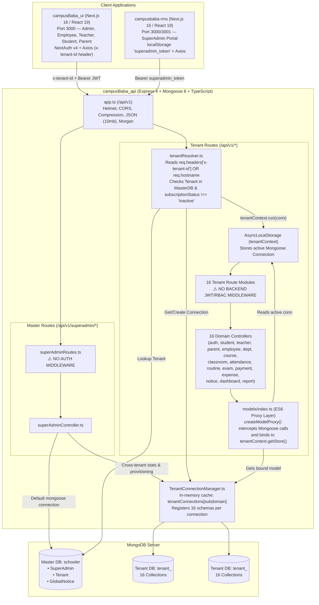

# Phase 1: Comprehensive System Audit (`00-audit.md`)

> **Status**: Phase 1 Complete — **Awaiting GATE 1 Approval**
> **Scope**: Read-only codebase verification, P0 defect evidence, schema & route inventory, aggregation analysis, Proxy/ALS dependency map, data-quality risk register, and Keep/Redesign/Drop matrix. No application code has been modified.

---

## 1. Current System Architecture Diagram (As-Built)

---

## 2. Verification of Section 2 (Current System) & Deviations

All items in Section 2 of `AGENT_BRIEF.md` were verified against the repository. Below are the exact confirmations and **deviations discovered**:

| Item | Brief Statement | Codebase Verification & Deviations Found |
| :--- | :--- | :--- |
| **`campusBaba_api` Stack** | Express 4, Mongoose 8, TypeScript, Zod, JWT, bcryptjs, `/api/v1` | **Confirmed** ([campusBaba_api/package.json](file:///d:/Personal-projects/campusbaba_saas/campusBaba_api/package.json#L22-L35)). **Deviation 1**: Port mismatch between [env.ts](file:///d:/Personal-projects/campusbaba_saas/campusBaba_api/src/config/env.ts#L7) (defaults `PORT` to `"5001"`), [server.ts](file:///d:/Personal-projects/campusbaba_saas/campusBaba_api/src/server.ts#L5) (fallback `5002`), [campusBaba_ui/src/lib/axios.ts](file:///d:/Personal-projects/campusbaba_saas/campusBaba_ui/src/lib/axios.ts#L5) (fallback `http://localhost:5000/api/v1`), and [campusbaba-rms/src/lib/api.ts](file:///d:/Personal-projects/campusbaba_saas/campusbaba-rms/src/lib/api.ts#L3) (fallback `http://localhost:5002/api/v1`). **Deviation 2**: `env.ts` loads `.env.local` ([env.ts](file:///d:/Personal-projects/campusbaba_saas/campusBaba_api/src/config/env.ts#L4)), but `database.ts` ([database.ts](file:///d:/Personal-projects/campusbaba_saas/campusBaba_api/src/config/database.ts#L8-L9)) and `authController.ts` ([authController.ts](file:///d:/Personal-projects/campusbaba_saas/campusBaba_api/src/controllers/authController.ts#L11-L13)) read `process.env` directly with insecure fallbacks instead of importing `env`. |
| **`campusBaba_ui` Stack & Roles** | Next.js 16, NextAuth v4, TanStack Query/Table, Tailwind v4, Recharts, i18next (en/bn), jsPDF, XLSX, QRCode. Roles: `admin`, `employee`, `teacher`, `student`, `parent` | **Confirmed** ([campusBaba_ui/package.json](file:///d:/Personal-projects/campusbaba_saas/campusBaba_ui/package.json#L11-L51)). **Deviation 3**: `employee` role has no separate portal layout; [middleware.ts](file:///d:/Personal-projects/campusbaba_saas/campusBaba_ui/src/middleware.ts#L10-L20) maps `employee` directly to `/admin/dashboard` and `/admin` prefix, giving any regular employee full UI access to the Admin portal. |
| **`campusbaba-rms` Features** | Next.js 16 SuperAdmin console (provision tenants, quotas, suspend/activate, global notices, billing, audit log) | **Confirmed** ([campusbaba-rms/package.json](file:///d:/Personal-projects/campusbaba_saas/campusbaba-rms/package.json#L11-L28)). **Deviation 4**: **Audit Log** ([audit-log/page.tsx](file:///d:/Personal-projects/campusbaba_saas/campusbaba-rms/src/app/dashboard/audit-log/page.tsx#L43-L116)), **Billing** ([billing/page.tsx](file:///d:/Personal-projects/campusbaba_saas/campusbaba-rms/src/app/dashboard/billing/page.tsx#L50-L105)), and **Settings** ([settings/page.tsx](file:///d:/Personal-projects/campusbaba_saas/campusbaba-rms/src/app/dashboard/settings/page.tsx#L62-L81)) are **UI-only mocks** with zero backend persistence or API endpoints. **Global Notices** are saved to Master DB (`GlobalNotice`), but **never fetched or displayed** in `campusBaba_ui`. |
| **Tenancy Mechanism** | Master DB `schooler` + `tenant_<subdomain>` DBs; `tenantResolver` + `TenantConnectionManager` + `AsyncLocalStorage` + ES6 Proxy | **Confirmed** ([tenantResolver.ts](file:///d:/Personal-projects/campusbaba_saas/campusBaba_api/src/middlewares/tenantResolver.ts), [TenantConnectionManager.ts](file:///d:/Personal-projects/campusbaba_saas/campusBaba_api/src/utils/TenantConnectionManager.ts), [asyncLocalStorage.ts](file:///d:/Personal-projects/campusbaba_saas/campusBaba_api/src/utils/asyncLocalStorage.ts), [models/index.ts](file:///d:/Personal-projects/campusbaba_saas/campusBaba_api/src/models/index.ts)). **Deviation 5**: `TenantConnectionManager.getMasterConnection()` ([TenantConnectionManager.ts](file:///d:/Personal-projects/campusbaba_saas/campusBaba_api/src/utils/TenantConnectionManager.ts#L8-L13)) is dead code—never called anywhere. Master models use the default `mongoose.connect()` connection initialized in [database.ts](file:///d:/Personal-projects/campusbaba_saas/campusBaba_api/src/config/database.ts#L11). |
| **16 Tenant Collections** | Counter, User, Student, Teacher, Parent, Employee, Department, Course, ClassRoom, Attendance, Routine, Exam, ExamMark, Payment, Expense, Notice | **Confirmed** ([TenantConnectionManager.ts](file:///d:/Personal-projects/campusbaba_saas/campusBaba_api/src/utils/TenantConnectionManager.ts#L23-L38)). |

---

## 3. P0 Defects Verification (With Exact File & Line Evidence)

### 3.1 Confirmations of the 11 P0 Defects from Brief

| # | Defect | Severity | File & Line Evidence | Code-Level Root Cause |
| :- | :--- | :--- | :--- | :--- |
| **P0-1** | `/api/v1/superadmin/*` has **no auth middleware** | Critical | [superAdminRoutes.ts:L20-L40](file:///d:/Personal-projects/campusbaba_saas/campusBaba_api/src/routes/superAdminRoutes.ts#L20-L40) [routes/index.ts:L25](file:///d:/Personal-projects/campusbaba_saas/campusBaba_api/src/routes/index.ts#L25) | Line 22 explicitly states: `// In a real app, this should be protected by a middleware checking for 'superadmin' role.` Every endpoint (`GET /tenants`, `POST /tenants`, `DELETE /tenants/:id`, `POST /tenants/:id/suspend`, etc.) is completely public to unauthenticated callers. |
| **P0-2** | Tenant routes have **no backend JWT/RBAC** | Critical | [routes/index.ts:L28-L46](file:///d:/Personal-projects/campusbaba_saas/campusBaba_api/src/routes/index.ts#L28-L46) [studentRoutes.ts:L12-L33](file:///d:/Personal-projects/campusbaba_saas/campusBaba_api/src/routes/studentRoutes.ts#L12-L33) | Only `tenantResolver` and `validateRequest` run on tenant routes. None of the 16 tenant route files verify a `Bearer` token or user role (except `GET /auth/me` and `POST /auth/change-password` inside [authController.ts:L169-L240](file:///d:/Personal-projects/campusbaba_saas/campusBaba_api/src/controllers/authController.ts#L169-L240)). Any unauthenticated caller passing a valid `x-tenant-id` header can read, create, update, or delete students, payments, marks, and expenses. |
| **P0-3** | Tenant resolved from spoofable **`x-tenant-id` header**; JWT lacks `tenant_id` | Critical | [tenantResolver.ts:L22-L30](file:///d:/Personal-projects/campusbaba_saas/campusBaba_api/src/middlewares/tenantResolver.ts#L22-L30) [authController.ts:L70-L79](file:///d:/Personal-projects/campusbaba_saas/campusBaba_api/src/controllers/authController.ts#L70-L79) | `let tenantId = req.headers["x-tenant-id"] as string;` takes precedence over `req.hostname`. Furthermore, `jwt.sign({ id, email, role, referenceId })` in `authController.ts` does not embed `tenantId`, and `JWT_SECRET` has a hardcoded fallback `"your-secret-key-change-this-in-production"` ([authController.ts:L11-L12](file:///d:/Personal-projects/campusbaba_saas/campusBaba_api/src/controllers/authController.ts#L11-L12)). A token issued for Tenant A is accepted on Tenant B if the user ID happens to exist or on endpoints that don't check JWT at all. |
| **P0-4** | **Hard-coded default SuperAdmin** (`admin@campusbaba.com` / `password123`) | Critical | [database.ts:L16-L29](file:///d:/Personal-projects/campusbaba_saas/campusBaba_api/src/config/database.ts#L16-L29) | On every server boot, `connectDatabase()` checks `SuperAdmin.findOne({ email: "admin@campusbaba.com" })` and auto-creates it with password `"password123"`. Also, [login/page.tsx:L158-L183](file:///d:/Personal-projects/campusbaba_saas/campusBaba_ui/src/app/login/page.tsx#L158-L183) hardcodes demo credentials (`admin@gmail.com` / `password123`) in the production login UI. |
| **P0-5** | Reports & dashboard filter `{ status: "paid" }` instead of `paymentStatus` | High | [reportController.ts:L10, L146, L222](file:///d:/Personal-projects/campusbaba_saas/campusBaba_api/src/controllers/reportController.ts#L10) [dashboardController.ts:L164](file:///d:/Personal-projects/campusbaba_saas/campusBaba_api/src/controllers/dashboardController.ts#L164) [Payment.ts:L70](file:///d:/Personal-projects/campusbaba_saas/campusBaba_api/src/models/Payment.ts#L70) | `Payment` schema defines `paymentStatus: "pending" \| "paid" \| "overdue" \| "cancelled"`, NOT `status`. Because `reportController.ts` (`getIncomeReport` L10, `getBusinessProjection` L146, `getProfitLossReport` L222) matches `{ status: "paid" }`, **all income reports, profit/loss reports, and business projections always return 0 income**! Similarly, `dashboardController.getPaymentTable` (L164) sets `filter.status = status`, ignoring the status filter. |
| **P0-6** | `deleteTenant` leaves the tenant database orphaned | High | [superAdminController.ts:L320-L337](file:///d:/Personal-projects/campusbaba_saas/campusBaba_api/src/controllers/superAdminController.ts#L320-L337) | Calls `await Tenant.findByIdAndDelete(id)` in Master DB without closing/evicting the cached connection in `TenantConnectionManager`, exporting data, or dropping `tenant_<subdomain>`. If a new tenant later registers the same subdomain, it inherits the old tenant's database! |
| **P0-7** | Tokens stored in `localStorage` (RMS) & exposed in NextAuth session | High | [campusbaba-rms/src/app/page.tsx:L24](file:///d:/Personal-projects/campusbaba_saas/campusbaba-rms/src/app/page.tsx#L24) [campusbaba-rms/src/lib/api.ts:L13-L28](file:///d:/Personal-projects/campusbaba_saas/campusbaba-rms/src/lib/api.ts#L13-L28) [campusBaba_ui/src/lib/auth.ts:L88](file:///d:/Personal-projects/campusbaba_saas/campusBaba_ui/src/lib/auth.ts#L88) | RMS stores `superadmin_token` directly in `localStorage` (vulnerable to XSS) with no refresh token or revocation mechanism. In `campusBaba_ui`, `session.user.accessToken` exposes the raw 7-day backend JWT to client-side JS via `getSession()`. |
| **P0-8** | Registration QR token is unsigned, unverified Base64 | Critical | [RegisterUserModal.tsx:L43-L54](file:///d:/Personal-projects/campusbaba_saas/campusBaba_ui/src/components/reusable/RegisterUserModal.tsx#L43-L54) [register/[token]/page.tsx:L20-L31, L89-L94](file:///d:/Personal-projects/campusbaba_saas/campusBaba_ui/src/app/register/%5Btoken%5D/page.tsx#L20-L31) [authController.ts:L112-L164](file:///d:/Personal-projects/campusbaba_saas/campusBaba_api/src/controllers/authController.ts#L112-L164) | `buildToken()` simply runs `btoa(JSON.stringify({ email, role, referenceId, name, exp }))` on the client. Worse still, `POST /api/v1/auth/register` ([authController.ts:L112](file:///d:/Personal-projects/campusbaba_saas/campusBaba_api/src/controllers/authController.ts#L112)) doesn't even take a token—it accepts raw `{ email, password, role, referenceId }` from anyone and allows creating an `admin` account linked to any existing `Employee._id`! |
| **P0-9** | Quota checks (`maxStudents`, `maxTeachers`, `maxAdmins`) are racy or missing | High | [studentController.ts:L13-L18](file:///d:/Personal-projects/campusbaba_saas/campusBaba_api/src/controllers/studentController.ts#L13-L18) [teacherController.ts:L13-L18](file:///d:/Personal-projects/campusbaba_saas/campusBaba_api/src/controllers/teacherController.ts#L13-L18) [employeeController.ts:L11-L23](file:///d:/Personal-projects/campusbaba_saas/campusBaba_api/src/controllers/employeeController.ts#L11-L23) | 1) `countDocuments({ status: "active" })` followed by `create()` is a classic TOCTOU race condition. 2) A tenant can bypass `maxStudents` by creating students with `status: "inactive"` and later updating them to `"active"` in `updateStudent` ([studentController.ts:L89-L106](file:///d:/Personal-projects/campusbaba_saas/campusBaba_api/src/controllers/studentController.ts#L89-L106)) or `updatePayment` ([paymentController.ts:L109-L111](file:///d:/Personal-projects/campusbaba_saas/campusBaba_api/src/controllers/paymentController.ts#L109-L111)), neither of which checks quotas. 3) `maxAdmins` is **never checked anywhere** in `employeeController.ts` or `authController.ts`. |
| **P0-10** | Static / overly permissive CORS configuration | High | [app.ts:L16-L24](file:///d:/Personal-projects/campusbaba_saas/campusBaba_api/src/app.ts#L16-L24) | Hardcodes `["https://campusbaba.onrender.com"]` in production and `origin: true` (reflects any origin with `credentials: true`) in development. Does not validate `*.campusbaba.com` subdomains or custom tenant domains. |
| **P0-11** | Plan prices hard-coded in RMS UI | Medium | [campusbaba-rms/src/app/dashboard/billing/page.tsx:L50-L54](file:///d:/Personal-projects/campusbaba_saas/campusbaba-rms/src/app/dashboard/billing/page.tsx#L50-L54) [campusbaba-rms/src/app/dashboard/page.tsx:L101](file:///d:/Personal-projects/campusbaba_saas/campusbaba-rms/src/app/dashboard/page.tsx#L101) | `PLAN_RATES = { postpaid: 5000, prepaid: 4500, enterprise: 15000 }` and `estimatedMRR = activeOrgs * 5000` are hardcoded in React components with no `plans` or `subscriptions` table in the backend. |

### 3.2 Additional Codebase Defects Discovered During Audit

| # | Defect | Location | Description |
| :- | :--- | :--- | :--- |
| **D-12** | Broken Polymorphic `refPath` in `User` and `Expense` | [User.ts:L37-L40](file:///d:/Personal-projects/campusbaba_saas/campusBaba_api/src/models/User.ts#L37-L40) [Expense.ts:L56-L59](file:///d:/Personal-projects/campusbaba_saas/campusBaba_api/src/models/Expense.ts#L56-L59) | In `User.ts`, `referenceId` declares `refPath: "role"`, where `role` values are lowercase (`"student"`, `"teacher"`, `"admin"`), which do not match registered Mongoose model names (`"Student"`, `"Teacher"`, `"Employee"`). In `Expense.ts`, `employeeId` declares `refPath: "employeeModel"`, a field that **does not exist** on `expenseSchema`, causing `.populate("employeeId")` in [expenseController.ts:L44](file:///d:/Personal-projects/campusbaba_saas/campusBaba_api/src/controllers/expenseController.ts#L44) to fail or return `null`. |
| **D-13** | Type Mismatch (`String` vs `ObjectId`) on Foreign Keys | [ExamMark.ts:L18-L27, L41-L44](file:///d:/Personal-projects/campusbaba_saas/campusBaba_api/src/models/ExamMark.ts#L18-L27) [Routine.ts:L25-L34](file:///d:/Personal-projects/campusbaba_saas/campusBaba_api/src/models/Routine.ts#L25-L34) [Attendance.ts:L40-L43](file:///d:/Personal-projects/campusbaba_saas/campusBaba_api/src/models/Attendance.ts#L40-L43) | `ExamMark` (`examId`, `studentId`, `evaluatedBy`), `Routine` (`classRoomId`, `teacherId`), and `Attendance` (`markedBy`) define foreign keys as `type: String` instead of `Schema.Types.ObjectId`, while controllers call `.populate()` on them expecting `_id` references. Meanwhile, `DATABASE_ARCHITECTURE.md` claims `ExamMark.examId` references `Exam.examId` (custom code), whereas `examController.getExamMarksByClassRoom` ([examController.ts:L273-L277](file:///d:/Personal-projects/campusbaba_saas/campusBaba_api/src/controllers/examController.ts#L273-L277)) queries `ExamMark.find({ examId: { $in: examIds } })` using `Exam._id`! |
| **D-14** | Published Exam Marks Hidden from Students & Invalid Sort Key | [examController.ts:L245-L258](file:///d:/Personal-projects/campusbaba_saas/campusBaba_api/src/controllers/examController.ts#L245-L258) | `getStudentExamResults` queries `status: { $in: ["evaluated"] }`, omitting `"published"`! Once an exam mark is transitioned to `"published"`, it disappears from the student's and parent's results view. It also calls `.sort("-examId.date")`, which does not work on populated documents in Mongoose. |
| **D-15** | `createExamSchema` Drops `examId` Validation | [exam.validator.ts:L3-L29](file:///d:/Personal-projects/campusbaba_saas/campusBaba_api/src/validators/exam.validator.ts#L3-L29) [Exam.ts:L22-L26](file:///d:/Personal-projects/campusbaba_saas/campusBaba_api/src/models/Exam.ts#L22-L26) | `Exam` requires `examId` (`unique: true`), and `examController.createExam` does not auto-generate it via `nextSequence`, nor does `createExamSchema` validate `examId`. |
| **D-16** | `ClassRoom.currentEnrollment` Never Maintained | [ClassRoom.ts:L51-L55](file:///d:/Personal-projects/campusbaba_saas/campusBaba_api/src/models/ClassRoom.ts#L51-L55) [studentController.ts:L11-L30](file:///d:/Personal-projects/campusbaba_saas/campusBaba_api/src/controllers/studentController.ts#L11-L30) | Creating, updating, or deleting a `Student` assigned to a `classRoomId` never increments or decrements `ClassRoom.currentEnrollment`, nor does it check `ClassRoom.capacity`. |

---

## 4. Complete Per-Collection Field Inventory

### 4.1 Master Database Collections (`schooler`)

#### 1. `SuperAdmin` ([SuperAdmin.ts](file:///d:/Personal-projects/campusbaba_saas/campusBaba_api/src/masterModels/SuperAdmin.ts))
| Field | Mongoose Type | Constraints / Defaults | Notes |
| :--- | :--- | :--- | :--- |
| `_id` | `ObjectId` | PK | Auto-generated |
| `name` | `String` | `required` | |
| `email` | `String` | `required`, `unique`, `lowercase`, `trim`, regex | |
| `password` | `String` | `required`, `minlength: 6` | Hashed via `bcrypt.genSalt(10)` in `pre("save")`; **not** `select: false` |
| `isActive` | `Boolean` | `default: true` | |
| `createdAt`, `updatedAt` | `Date` | `timestamps: true` | |

#### 2. `Tenant` ([Tenant.ts](file:///d:/Personal-projects/campusbaba_saas/campusBaba_api/src/masterModels/Tenant.ts))
| Field | Mongoose Type | Constraints / Defaults | Notes |
| :--- | :--- | :--- | :--- |
| `_id` | `ObjectId` | PK | |
| `name` | `String` | `required`, `trim` | Institution name |
| `subdomain` | `String` | `required`, `unique`, `lowercase`, `trim`, indexed | Used as tenant slug |
| `dbURI` | `String` | `required` | Full MongoDB URI (`.../tenant_<subdomain>`) |
| `subscriptionStatus` | `String` | `enum: ["active", "inactive", "past_due"]`, `default: "active"` | Only `"inactive"` is blocked in `tenantResolver` |
| `billingPlan` | `String` | `default: "postpaid"` | Unconstrained string in DB (`postpaid`, `prepaid`, `enterprise` in UI) |
| `maxStudents` | `Number` | `default: 100` | Checked non-atomically in `createStudent` |
| `maxTeachers` | `Number` | `default: 10` | Checked non-atomically in `createTeacher` |
| `maxAdmins` | `Number` | `default: 3` | Never enforced in backend |
| `createdAt`, `updatedAt` | `Date` | `timestamps: true` | |

#### 3. `GlobalNotice` ([GlobalNotice.ts](file:///d:/Personal-projects/campusbaba_saas/campusBaba_api/src/masterModels/GlobalNotice.ts))
| Field | Mongoose Type | Constraints / Defaults | Notes |
| :--- | :--- | :--- | :--- |
| `_id` | `ObjectId` | PK | |
| `title` | `String` | `required`, `trim`, `maxlength: 200` | |
| `content` | `String` | `required`, `trim` | |
| `category` | `String` | `required`, `enum: ["general", "academic", "exam", "event", "holiday", "urgent"]` | Indexed `{ category: 1, status: 1 }` |
| `targetAudience` | `[String]` | `required`, `enum: ["student", "parent", "teacher", "employee", "all"]` | |
| `targetOrganizations` | `[String]` | `default: ["all"]` | Array of tenant `_id`s or `["all"]` |
| `priority` | `String` | `enum: ["low", "medium", "high"]`, `default: "medium"` | |
| `status` | `String` | `enum: ["draft", "published", "archived"]`, `default: "published"` | Indexed `{ status: 1, publishDate: -1 }` |
| `publishDate` | `Date` | `default: Date.now` | |
| `expiryDate` | `Date` | optional | |
| `createdBy` | `ObjectId` | `ref: "SuperAdmin"`, optional | Never populated or set by `createGlobalNotice` |
| `createdAt`, `updatedAt` | `Date` | `timestamps: true` | |

---

### 4.2 Tenant Database Collections (`tenant_<subdomain>`)

#### 1. `Counter` ([Counter.ts](file:///d:/Personal-projects/campusbaba_saas/campusBaba_api/src/models/Counter.ts))
- `_id`: `String` (`required`, e.g., `"student"`, `"teacher"`, `"parent"`, `"employee"`, `"classroom"`, `"payment"`)
- `seq`: `Number` (`default: 0`)

#### 2. `User` ([User.ts](file:///d:/Personal-projects/campusbaba_saas/campusBaba_api/src/models/User.ts))
- `_id`: `ObjectId`
- `email`: `String` (`required`, `unique`, `lowercase`, `trim`, indexed)
- `password`: `String` (`required`, `minlength: 6`, bcrypt hashed in `pre("save")`)
- `role`: `String` (`required`, `enum: ["admin", "teacher", "student", "parent", "employee"]`)
- `referenceId`: `ObjectId` (`required`, `refPath: "role"` — *broken case mapping, see D-12*)
- `isActive`: `Boolean` (`default: true`)
- `lastLogin`: `Date` (optional)
- `createdAt`, `updatedAt`: `Date`
- Indexes: `{ email: 1 }`, `{ role: 1, referenceId: 1 }`

#### 3. `Student` ([Student.ts](file:///d:/Personal-projects/campusbaba_saas/campusBaba_api/src/models/Student.ts))
- `_id`: `ObjectId`
- `studentId`: `String` (`unique`, `sparse`, `trim`, generated as `STU-0001`)
- `firstName`, `lastName`: `String` (`required`, `trim`, `maxlength: 50`)
- `email`: `String` (`required`, `unique`, `lowercase`, `trim`, indexed)
- `phone`: `String` (`required`, `trim`)
- `dateOfBirth`: `Date` (`required`)
- `gender`: `String` (`required`, `enum: ["male", "female", "other"]`)
- `address`: Embedded `{ street, city, state, zipCode, country }` (all `String`, `required`)
- `parentId`: `ObjectId` (`ref: "Parent"`, optional, indexed)
- `enrollmentDate`: `Date` (`default: Date.now`)
- `status`: `String` (`enum: ["active", "inactive", "graduated", "suspended"]`, `default: "active"`, indexed)
- `classRoomId`: `ObjectId` (`ref: "ClassRoom"`, optional, indexed)
- `profileImage`: `String` (optional)
- `emergencyContact`: Embedded `{ name, relationship, phone }` (all `String`, `required`)
- `medicalInfo`: Embedded `{ bloodGroup?: String, allergies?: [String], medications?: [String] }`
- `createdAt`, `updatedAt`: `Date`

#### 4. `Teacher` ([Teacher.ts](file:///d:/Personal-projects/campusbaba_saas/campusBaba_api/src/models/Teacher.ts))
- `_id`: `ObjectId`
- `teacherId`: `String` (`unique`, `sparse`, `trim`, generated as `TCH-0001`)
- `firstName`, `lastName`: `String` (`required`, `trim`, `maxlength: 50`)
- `email`: `String` (`required`, `unique`, `lowercase`, `trim`, indexed)
- `phone`: `String` (`required`, `trim`)
- `dateOfBirth`: `Date` (`required`)
- `gender`: `String` (`required`, `enum: ["male", "female", "other"]`)
- `address`: Embedded `{ street, city, state, zipCode, country }` (all `required`)
- `qualification`: `String` (`required`)
- `specialization`: `[String]` (`required`)
- `experience`: `Number` (`required`, `min: 0`)
- `joiningDate`: `Date` (`default: Date.now`)
- `salary`: `Number` (`required`, `min: 0`)
- `status`: `String` (`enum: ["active", "inactive", "on-leave"]`, `default: "active"`, indexed)
- `departmentId`: `ObjectId` (`ref: "Department"`, optional, indexed)
- `profileImage`: `String` (optional)
- `emergencyContact`: Embedded `{ name, relationship, phone }` (all `required`)
- `createdAt`, `updatedAt`: `Date`

#### 5. `Parent` ([Parent.ts](file:///d:/Personal-projects/campusbaba_saas/campusBaba_api/src/models/Parent.ts))
- `_id`: `ObjectId`
- `parentId`: `String` (`unique`, `sparse`, `trim`, generated as `PAR-0001`)
- `firstName`, `lastName`: `String` (`required`, `trim`, `maxlength: 50`)
- `email`: `String` (`required`, `unique`, `lowercase`, `trim`, indexed)
- `phone`: `String` (`required`, `trim`)
- `occupation`: `String` (`trim`, optional)
- `address`: Embedded `{ street, city, state, zipCode, country }` (all `required`)
- `relationship`: `String` (`required`, `enum: ["father", "mother", "guardian"]`)
- `profileImage`: `String` (optional)
- `createdAt`, `updatedAt`: `Date`

#### 6. `Employee` ([Employee.ts](file:///d:/Personal-projects/campusbaba_saas/campusBaba_api/src/models/Employee.ts))
- `_id`: `ObjectId`
- `employeeId`: `String` (`unique`, `sparse`, `trim`, generated as `EMP-0001` or `ADM-<timestamp>`)
- `firstName`, `lastName`: `String` (`required`, `trim`, `maxlength: 50`)
- `email`: `String` (`required`, `unique`, `lowercase`, `trim`, indexed)
- `phone`: `String` (`required`, `trim`)
- `dateOfBirth`: `Date` (`required`)
- `gender`: `String` (`required`, `enum: ["male", "female", "other"]`)
- `address`: Embedded `{ street, city, state, zipCode, country }` (all `required`)
- `position`: `String` (`required`)
- `department`: `String` (`required`, indexed — *plain string, not `ObjectId` ref to `Department`*)
- `joiningDate`: `Date` (`default: Date.now`)
- `salary`: `Number` (`required`, `min: 0`)
- `status`: `String` (`enum: ["active", "inactive", "on-leave"]`, `default: "active"`, indexed)
- `profileImage`: `String` (optional)
- `emergencyContact`: Embedded `{ name, relationship, phone }` (all `required`)
- `createdAt`, `updatedAt`: `Date`

#### 7. `Department` ([Department.ts](file:///d:/Personal-projects/campusbaba_saas/campusBaba_api/src/models/Department.ts))
- `_id`: `ObjectId`
- `name`: `String` (`required`, `unique`, `trim`)
- `code`: `String` (`required`, `unique`, `uppercase`, `trim`, indexed)
- `description`: `String` (`trim`, optional)
- `headOfDepartment`: `ObjectId` (`ref: "Teacher"`, optional)
- `status`: `String` (`enum: ["active", "inactive"]`, `default: "active"`, indexed)
- `createdAt`, `updatedAt`: `Date`

#### 8. `Course` ([Course.ts](file:///d:/Personal-projects/campusbaba_saas/campusBaba_api/src/models/Course.ts))
- `_id`: `ObjectId`
- `name`: `String` (`required`, `trim`)
- `code`: `String` (`required`, `unique`, `uppercase`, `trim`, indexed)
- `description`: `String` (`trim`, optional)
- `departmentId`: `ObjectId` (`ref: "Department"`, `required`, indexed)
- `credits`: `Number` (`required`, `min: 1`)
- `duration`: `Number` (`required`, `min: 1`, in months)
- `status`: `String` (`enum: ["active", "inactive"]`, `default: "active"`, indexed)
- `createdAt`, `updatedAt`: `Date`

#### 9. `ClassRoom` ([ClassRoom.ts](file:///d:/Personal-projects/campusbaba_saas/campusBaba_api/src/models/ClassRoom.ts))
- `_id`: `ObjectId`
- `classRoomId`: `String` (`required`, `unique`, `trim`, generated as `CR-0001`)
- `name`: `String` (`required`, `trim`)
- `roomNumber`: `String` (`required`, `trim`)
- `departmentId`: `ObjectId` (`ref: "Department"`, `required`)
- `courseId`: `ObjectId` (`ref: "Course"`, `required`)
- `capacity`: `Number` (`required`, `min: 1`)
- `currentEnrollment`: `Number` (`default: 0`, `min: 0`)
- `academicYear`: `String` (`required`)
- `semester`: `String` (`required`)
- `status`: `String` (`enum: ["active", "inactive", "completed"]`, `default: "active"`, indexed)
- `createdAt`, `updatedAt`: `Date`
- Compound Indexes: `{ departmentId: 1, courseId: 1 }`, `{ academicYear: 1, semester: 1 }`

#### 10. `Attendance` ([Attendance.ts](file:///d:/Personal-projects/campusbaba_saas/campusBaba_api/src/models/Attendance.ts))
- `_id`: `ObjectId`
- `studentId`: `ObjectId` (`ref: "Student"`, `required`)
- `classRoomId`: `ObjectId` (`ref: "ClassRoom"`, `required`)
- `date`: `Date` (`required`, `default: Date.now`)
- `status`: `String` (`required`, `enum: ["present", "absent", "late", "excused"]`)
- `remarks`: `String` (optional)
- `markedBy`: `String` (`required` — *plain string in schema, but populated in controller as if it were a `Teacher` ObjectId*)
- `createdAt`, `updatedAt`: `Date`
- Indexes: `{ studentId: 1, classRoomId: 1, date: 1 }` (**unique**), `{ classRoomId: 1, date: 1 }`, `{ studentId: 1, date: 1 }`

#### 11. `Routine` ([Routine.ts](file:///d:/Personal-projects/campusbaba_saas/campusBaba_api/src/models/Routine.ts))
- `_id`: `ObjectId`
- `classRoomId`: `String` (`ref: "ClassRoom"`, `required` — *String instead of ObjectId*)
- `teacherId`: `String` (`ref: "Teacher"`, `required` — *String instead of ObjectId*)
- `dayOfWeek`: `String` (`required`, `enum: ["monday".."sunday"]`)
- `startTime`, `endTime`: `String` (`required`, regex `HH:MM`)
- `subject`: `String` (`required`, `trim`)
- `roomNumber`: `String` (`required`, `trim`)
- `status`: `String` (`enum: ["active", "cancelled", "rescheduled"]`, `default: "active"`)
- `createdAt`, `updatedAt`: `Date`
- Indexes: `{ classRoomId: 1, dayOfWeek: 1 }`, `{ teacherId: 1, dayOfWeek: 1 }`

#### 12. `Exam` ([Exam.ts](file:///d:/Personal-projects/campusbaba_saas/campusBaba_api/src/models/Exam.ts))
- `_id`: `ObjectId`
- `examId`: `String` (`required`, `unique`)
- `name`: `String` (`required`, `trim`)
- `examType`: `String` (`required`, `enum: ["midterm", "final", "quiz", "assignment", "practical"]`)
- `courseId`: `ObjectId` (`ref: "Course"`, `required`)
- `classRoomId`: `ObjectId` (`ref: "ClassRoom"`, `required`)
- `date`: `Date` (`required`)
- `startTime`, `endTime`: `String` (`required`, regex `HH:MM`)
- `totalMarks`: `Number` (`required`, `min: 1`)
- `passingMarks`: `Number` (`required`, `min: 0`)
- `instructions`: `String` (`trim`, optional)
- `status`: `String` (`enum: ["scheduled", "ongoing", "completed", "cancelled"]`, `default: "scheduled"`, indexed)
- `createdAt`, `updatedAt`: `Date`
- Indexes: `{ courseId: 1, date: 1 }`, `{ classRoomId: 1, date: 1 }`

#### 13. `ExamMark` ([ExamMark.ts](file:///d:/Personal-projects/campusbaba_saas/campusBaba_api/src/models/ExamMark.ts))
- `_id`: `ObjectId`
- `examId`: `String` (`ref: "Exam"`, `required` — *String instead of ObjectId*)
- `studentId`: `String` (`ref: "Student"`, `required` — *String instead of ObjectId*)
- `marksObtained`: `Number` (`required`, `min: 0`)
- `grade`: `String` (`trim`, optional)
- `remarks`: `String` (`trim`, optional)
- `evaluatedBy`: `String` (`ref: "Teacher"`, optional — *String instead of ObjectId*)
- `evaluatedAt`: `Date` (optional)
- `status`: `String` (`enum: ["pending", "evaluated", "published"]`, `default: "pending"`)
- `createdAt`, `updatedAt`: `Date`
- Indexes: `{ examId: 1, studentId: 1 }` (**unique**), `{ studentId: 1 }`, `{ examId: 1, status: 1 }`

#### 14. `Payment` ([Payment.ts](file:///d:/Personal-projects/campusbaba_saas/campusBaba_api/src/models/Payment.ts))
- `_id`: `ObjectId`
- `paymentId`: `String` (`unique`, `sparse`, `trim`, generated as `PAY-0001`, indexed)
- `studentId`: `ObjectId` (`ref: "Student"`, `required`)
- `courseId`: `ObjectId` (`ref: "Course"`, `required`)
- `amount`: `Number` (`required`, `min: 0` — *floating point JS Number, not Decimal/numeric*)
- `paymentType`: `String` (`required`, `enum: ["tuition", "exam", "library", "transport", "hostel", "other"]`)
- `paymentMethod`: `String` (`enum: ["cash", "card", "bank-transfer", "online"]`, optional)
- `transactionId`: `String` (`trim`, optional — *not unique!*)
- `dueDate`: `Date` (`required`)
- `paidDate`: `Date` (optional)
- `paymentStatus`: `String` (`enum: ["pending", "paid", "overdue", "cancelled"]`, `default: "pending"`)
- `academicYear`: `String` (`required`)
- `semester`: `String` (`required`)
- `remarks`: `String` (`trim`, optional)
- `createdAt`, `updatedAt`: `Date`
- Indexes: `{ studentId: 1, paymentStatus: 1 }`, `{ courseId: 1, paymentStatus: 1 }`, `{ dueDate: 1, paymentStatus: 1 }`, `{ academicYear: 1, semester: 1 }`

#### 15. `Expense` ([Expense.ts](file:///d:/Personal-projects/campusbaba_saas/campusBaba_api/src/models/Expense.ts))
- `_id`: `ObjectId`
- `category`: `String` (`required`, `enum: ["salary", "fixed", "other"]`)
- `subcategory`: `String` (`required`, `trim`)
- `amount`: `Number` (`required`, `min: 0`)
- `description`: `String` (`required`, `trim`)
- `date`: `Date` (`required`, `default: Date.now`)
- `paymentMethod`: `String` (`required`, `enum: ["cash", "card", "bank-transfer", "cheque"]`)
- `transactionId`: `String` (`trim`, optional)
- `employeeId`: `String` (`refPath: "employeeModel"`, optional, indexed — *broken refPath, see D-12*)
- `approvedBy`: `String` (`ref: "Employee"`, optional — *String instead of ObjectId*)
- `status`: `String` (`enum: ["pending", "approved", "paid", "rejected"]`, `default: "pending"`, indexed)
- `attachments`: `[String]` (optional)
- `remarks`: `String` (`trim`, optional)
- `createdAt`, `updatedAt`: `Date`
- Index: `{ category: 1, date: 1 }`

#### 16. `Notice` ([Notice.ts](file:///d:/Personal-projects/campusbaba_saas/campusBaba_api/src/models/Notice.ts))
- `_id`: `ObjectId`
- `title`: `String` (`required`, `trim`, `maxlength: 200`)
- `content`: `String` (`required`, `trim`)
- `category`: `String` (`required`, `enum: ["general", "academic", "exam", "event", "holiday", "urgent"]`)
- `targetAudience`: `[String]` (`required`, `enum: ["student", "parent", "teacher", "employee", "all"]`)
- `publishDate`: `Date` (`required`, `default: Date.now`)
- `expiryDate`: `Date` (optional)
- `attachments`: `[String]` (optional)
- `createdBy`: `ObjectId` (`required`, `refPath: "createdByModel"`)
- `createdByModel`: `String` (`required`, `enum: ["Teacher", "Employee"]`)
- `modifiedBy`: `ObjectId` (`refPath: "modifiedByModel"`, optional)
- `modifiedByModel`: `String` (`enum: ["Teacher", "Employee"]`, optional)
- `status`: `String` (`enum: ["draft", "published", "archived"]`, `default: "draft"`)
- `priority`: `String` (`enum: ["low", "medium", "high"]`, `default: "medium"`)
- `createdAt`, `updatedAt`: `Date`
- Indexes: `{ status: 1, publishDate: -1 }`, `{ category: 1, status: 1 }`, `{ targetAudience: 1, status: 1 }`

---

## 5. Complete Route Inventory (`campusBaba_api`)

All routes are mounted under `/api/v1` in [routes/index.ts](file:///d:/Personal-projects/campusbaba_saas/campusBaba_api/src/routes/index.ts).

| Route Group | Method & Path | Tenant Resolver? | Zod Validator | Auth / RBAC Middleware | Controller Function |
| :--- | :--- | :---: | :--- | :---: | :--- |
| **Health** | `GET /health` | ❌ | None | ❌ None | Inline ([app.ts:L41](file:///d:/Personal-projects/campusbaba_saas/campusBaba_api/src/app.ts#L41)) |
| **SuperAdmin** | `POST /superadmin/login` | ❌ | None | ❌ None | `superAdminController.loginSuperAdmin` |
| **SuperAdmin** | `GET /superadmin/dashboard-stats` | ❌ | None | ❌ **MISSING (P0-1)** | `superAdminController.getDashboardStats` |
| **SuperAdmin** | `GET /superadmin/tenants` | ❌ | None | ❌ **MISSING (P0-1)** | `superAdminController.getTenants` |
| **SuperAdmin** | `POST /superadmin/tenants` | ❌ | None | ❌ **MISSING (P0-1)** | `superAdminController.provisionTenant` |
| **SuperAdmin** | `GET /superadmin/tenants/:id/details` | ❌ | None | ❌ **MISSING (P0-1)** | `superAdminController.getTenantDetails` |
| **SuperAdmin** | `PUT /superadmin/tenants/:id` | ❌ | None | ❌ **MISSING (P0-1)** | `superAdminController.updateTenant` |
| **SuperAdmin** | `POST /superadmin/tenants/:id/suspend` | ❌ | None | ❌ **MISSING (P0-1)** | `superAdminController.suspendTenant` |
| **SuperAdmin** | `POST /superadmin/tenants/:id/activate` | ❌ | None | ❌ **MISSING (P0-1)** | `superAdminController.activateTenant` |
| **SuperAdmin** | `DELETE /superadmin/tenants/:id` | ❌ | None | ❌ **MISSING (P0-1)** | `superAdminController.deleteTenant` |
| **SuperAdmin** | `GET /superadmin/notices` | ❌ | None | ❌ **MISSING (P0-1)** | `superAdminController.getGlobalNotices` |
| **SuperAdmin** | `POST /superadmin/notices` | ❌ | None | ❌ **MISSING (P0-1)** | `superAdminController.createGlobalNotice` |
| **SuperAdmin** | `PUT /superadmin/notices/:id` | ❌ | None | ❌ **MISSING (P0-1)** | `superAdminController.updateGlobalNotice` |
| **SuperAdmin** | `DELETE /superadmin/notices/:id` | ❌ | None | ❌ **MISSING (P0-1)** | `superAdminController.deleteGlobalNotice` |
| **Auth** | `POST /auth/login` | ✅ | None | Public | `authController.login` |
| **Auth** | `POST /auth/register` | ✅ | None | ❌ **Unprotected (P0-8)** | `authController.register` |
| **Auth** | `GET /auth/me` | ✅ | None | Inline JWT check (no tenant check) | `authController.getCurrentUser` |
| **Auth** | `POST /auth/change-password` | ✅ | None | Inline JWT check (no tenant check) | `authController.changePassword` |
| **Students** | `POST /students` | ✅ | `createStudentSchema` | ❌ **MISSING (P0-2)** | `studentController.createStudent` |
| **Students** | `GET /students` | ✅ | None | ❌ **MISSING (P0-2)** | `studentController.getAllStudents` |
| **Students** | `GET /students/stats` | ✅ | None | ❌ **MISSING (P0-2)** | `studentController.getStudentStats` |
| **Students** | `GET /students/:id` | ✅ | `getStudentSchema` | ❌ **MISSING (P0-2)** | `studentController.getStudentById` |
| **Students** | `PUT /students/:id` | ✅ | `updateStudentSchema` | ❌ **MISSING (P0-2)** | `studentController.updateStudent` |
| **Students** | `DELETE /students/:id` | ✅ | `getStudentSchema` | ❌ **MISSING (P0-2)** | `studentController.deleteStudent` |
| **Parents** | `POST /parents` | ✅ | `createParentSchema` | ❌ **MISSING (P0-2)** | `parentController.createParent` |
| **Parents** | `GET /parents` | ✅ | None | ❌ **MISSING (P0-2)** | `parentController.getAllParents` |
| **Parents** | `GET /parents/:id` | ✅ | None | ❌ **MISSING (P0-2)** | `parentController.getParentById` |
| **Parents** | `GET /parents/:id/children` | ✅ | None | ❌ **MISSING (P0-2)** | `parentController.getParentChildren` |
| **Parents** | `PUT /parents/:id` | ✅ | `updateParentSchema` | ❌ **MISSING (P0-2)** | `parentController.updateParent` |
| **Parents** | `DELETE /parents/:id` | ✅ | None | ❌ **MISSING (P0-2)** | `parentController.deleteParent` |
| **Teachers** | `POST /teachers` | ✅ | `createTeacherSchema` | ❌ **MISSING (P0-2)** | `teacherController.createTeacher` |
| **Teachers** | `GET /teachers` | ✅ | None | ❌ **MISSING (P0-2)** | `teacherController.getAllTeachers` |
| **Teachers** | `GET /teachers/stats` | ✅ | None | ❌ **MISSING (P0-2)** | `teacherController.getTeacherStats` |
| **Teachers** | `GET /teachers/:id` | ✅ | None | ❌ **MISSING (P0-2)** | `teacherController.getTeacherById` |
| **Teachers** | `PUT /teachers/:id` | ✅ | `updateTeacherSchema` | ❌ **MISSING (P0-2)** | `teacherController.updateTeacher` |
| **Teachers** | `DELETE /teachers/:id` | ✅ | None | ❌ **MISSING (P0-2)** | `teacherController.deleteTeacher` |
| **Employees** | `POST /employees` | ✅ | `createEmployeeSchema` | ❌ **MISSING (P0-2)** | `employeeController.createEmployee` |
| **Employees** | `GET /employees` | ✅ | None | ❌ **MISSING (P0-2)** | `employeeController.getAllEmployees` |
| **Employees** | `GET /employees/stats` | ✅ | None | ❌ **MISSING (P0-2)** | `employeeController.getEmployeeStats` |
| **Employees** | `GET /employees/:id` | ✅ | None | ❌ **MISSING (P0-2)** | `employeeController.getEmployeeById` |
| **Employees** | `PUT /employees/:id` | ✅ | `updateEmployeeSchema` | ❌ **MISSING (P0-2)** | `employeeController.updateEmployee` |
| **Employees** | `DELETE /employees/:id` | ✅ | None | ❌ **MISSING (P0-2)** | `employeeController.deleteEmployee` |
| **Departments**| `POST /departments` | ✅ | `createDepartmentSchema`| ❌ **MISSING (P0-2)** | `departmentController.createDepartment` |
| **Departments**| `GET /departments` | ✅ | None | ❌ **MISSING (P0-2)** | `departmentController.getAllDepartments` |
| **Departments**| `GET /departments/:id` | ✅ | None | ❌ **MISSING (P0-2)** | `departmentController.getDepartmentById` |
| **Departments**| `PUT /departments/:id` | ✅ | `updateDepartmentSchema`| ❌ **MISSING (P0-2)** | `departmentController.updateDepartment` |
| **Departments**| `DELETE /departments/:id` | ✅ | None | ❌ **MISSING (P0-2)** | `departmentController.deleteDepartment` |
| **Courses** | `POST /courses` | ✅ | `createCourseSchema` | ❌ **MISSING (P0-2)** | `courseController.createCourse` |
| **Courses** | `GET /courses` | ✅ | None | ❌ **MISSING (P0-2)** | `courseController.getAllCourses` |
| **Courses** | `GET /courses/:id` | ✅ | None | ❌ **MISSING (P0-2)** | `courseController.getCourseById` |
| **Courses** | `PUT /courses/:id` | ✅ | `updateCourseSchema` | ❌ **MISSING (P0-2)** | `courseController.updateCourse` |
| **Courses** | `DELETE /courses/:id` | ✅ | None | ❌ **MISSING (P0-2)** | `courseController.deleteCourse` |
| **ClassRooms** | `POST /classrooms` | ✅ | `createClassRoomSchema` | ❌ **MISSING (P0-2)** | `classRoomController.createClassRoom` |
| **ClassRooms** | `GET /classrooms` | ✅ | None | ❌ **MISSING (P0-2)** | `classRoomController.getAllClassRooms` |
| **ClassRooms** | `GET /classrooms/teacher/:teacherId` | ✅ | None | ❌ **MISSING (P0-2)** | `classRoomController.getClassRoomsByTeacher` |
| **ClassRooms** | `GET /classrooms/:id` | ✅ | None | ❌ **MISSING (P0-2)** | `classRoomController.getClassRoomById` |
| **ClassRooms** | `GET /classrooms/:id/students` | ✅ | None | ❌ **MISSING (P0-2)** | `classRoomController.getClassRoomStudents` |
| **ClassRooms** | `PUT /classrooms/:id` | ✅ | `updateClassRoomSchema` | ❌ **MISSING (P0-2)** | `classRoomController.updateClassRoom` |
| **ClassRooms** | `DELETE /classrooms/:id` | ✅ | None | ❌ **MISSING (P0-2)** | `classRoomController.deleteClassRoom` |
| **Attendance** | `POST /attendance` | ✅ | `createAttendanceSchema`| ❌ **MISSING (P0-2)** | `attendanceController.createAttendance` |
| **Attendance** | `POST /attendance/bulk` | ✅ | `bulkAttendanceSchema` | ❌ **MISSING (P0-2)** | `attendanceController.bulkCreateAttendance` |
| **Attendance** | `GET /attendance` | ✅ | None | ❌ **MISSING (P0-2)** | `attendanceController.getAllAttendance` |
| **Attendance** | `GET /attendance/stats` | ✅ | None | ❌ **MISSING (P0-2)** | `attendanceController.getAttendanceStats` |
| **Attendance** | `GET /attendance/classroom/:classRoomId`| ✅ | None | ❌ **MISSING (P0-2)** | `attendanceController.getAttendanceByClassRoom`|
| **Attendance** | `PUT /attendance/:id` | ✅ | None | ❌ **MISSING (P0-2)** | `attendanceController.updateAttendance` |
| **Attendance** | `DELETE /attendance/:id` | ✅ | None | ❌ **MISSING (P0-2)** | `attendanceController.deleteAttendance` |
| **Routines** | `POST /routines` | ✅ | `createRoutineSchema` | ❌ **MISSING (P0-2)** | `routineController.createRoutine` |
| **Routines** | `GET /routines` | ✅ | None | ❌ **MISSING (P0-2)** | `routineController.getAllRoutines` |
| **Routines** | `GET /routines/classroom/:classRoomId` | ✅ | None | ❌ **MISSING (P0-2)** | `routineController.getRoutineByClassRoom` |
| **Routines** | `GET /routines/teacher/:teacherId` | ✅ | None | ❌ **MISSING (P0-2)** | `routineController.getRoutineByTeacher` |
| **Routines** | `GET /routines/:id` | ✅ | None | ❌ **MISSING (P0-2)** | `routineController.getRoutineById` |
| **Routines** | `PUT /routines/:id` | ✅ | `updateRoutineSchema` | ❌ **MISSING (P0-2)** | `routineController.updateRoutine` |
| **Routines** | `DELETE /routines/:id` | ✅ | None | ❌ **MISSING (P0-2)** | `routineController.deleteRoutine` |
| **Exams/Marks**| `POST /exams/marks` | ✅ | `createExamMarkSchema` | ❌ **MISSING (P0-2)** | `examController.createExamMark` |
| **Exams/Marks**| `GET /exams/marks` | ✅ | None | ❌ **MISSING (P0-2)** | `examController.getAllExamMarks` |
| **Exams/Marks**| `GET /exams/marks/classroom/:classRoomId`| ✅ | None | ❌ **MISSING (P0-2)** | `examController.getExamMarksByClassRoom` |
| **Exams/Marks**| `GET /exams/marks/student/:studentId` | ✅ | None | ❌ **MISSING (P0-2)** | `examController.getStudentExamResults` |
| **Exams/Marks**| `GET /exams/marks/:id` | ✅ | None | ❌ **MISSING (P0-2)** | `examController.getExamMarkById` |
| **Exams/Marks**| `PUT /exams/marks/:id` | ✅ | `updateExamMarkSchema` | ❌ **MISSING (P0-2)** | `examController.updateExamMark` |
| **Exams/Marks**| `DELETE /exams/marks/:id` | ✅ | None | ❌ **MISSING (P0-2)** | `examController.deleteExamMark` |
| **Exams** | `POST /exams` | ✅ | `createExamSchema` | ❌ **MISSING (P0-2)** | `examController.createExam` |
| **Exams** | `GET /exams` | ✅ | None | ❌ **MISSING (P0-2)** | `examController.getAllExams` |
| **Exams** | `GET /exams/classroom/:classRoomId` | ✅ | None | ❌ **MISSING (P0-2)** | `examController.getExamsByClassRoom` |
| **Exams** | `GET /exams/:id` | ✅ | None | ❌ **MISSING (P0-2)** | `examController.getExamById` |
| **Exams** | `PUT /exams/:id` | ✅ | `updateExamSchema` | ❌ **MISSING (P0-2)** | `examController.updateExam` |
| **Exams** | `DELETE /exams/:id` | ✅ | None | ❌ **MISSING (P0-2)** | `examController.deleteExam` |
| **Payments** | `POST /payments` | ✅ | `createPaymentSchema` | ❌ **MISSING (P0-2)** | `paymentController.createPayment` |
| **Payments** | `GET /payments` | ✅ | None | ❌ **MISSING (P0-2)** | `paymentController.getAllPayments` |
| **Payments** | `GET /payments/stats` | ✅ | None | ❌ **MISSING (P0-2)** | `paymentController.getPaymentStats` |
| **Payments** | `GET /payments/enrollments` | ✅ | None | ❌ **MISSING (P0-2)** | `paymentController.getEnrolledStudents` |
| **Payments** | `GET /payments/student/:studentId` | ✅ | None | ❌ **MISSING (P0-2)** | `paymentController.getStudentPayments` |
| **Payments** | `GET /payments/:id` | ✅ | None | ❌ **MISSING (P0-2)** | `paymentController.getPaymentById` |
| **Payments** | `PUT /payments/:id` | ✅ | `updatePaymentSchema` | ❌ **MISSING (P0-2)** | `paymentController.updatePayment` |
| **Payments** | `PATCH /payments/:id/activate-student` | ✅ | None | ❌ **MISSING (P0-2)** | `paymentController.activateStudent` |
| **Payments** | `DELETE /payments/:id` | ✅ | None | ❌ **MISSING (P0-2)** | `paymentController.deletePayment` |
| **Expenses** | `POST /expenses` | ✅ | `createExpenseSchema` | ❌ **MISSING (P0-2)** | `expenseController.createExpense` |
| **Expenses** | `GET /expenses` | ✅ | None | ❌ **MISSING (P0-2)** | `expenseController.getAllExpenses` |
| **Expenses** | `GET /expenses/stats` | ✅ | None | ❌ **MISSING (P0-2)** | `expenseController.getExpenseStats` |
| **Expenses** | `GET /expenses/:id` | ✅ | None | ❌ **MISSING (P0-2)** | `expenseController.getExpenseById` |
| **Expenses** | `PUT /expenses/:id` | ✅ | `updateExpenseSchema` | ❌ **MISSING (P0-2)** | `expenseController.updateExpense` |
| **Expenses** | `DELETE /expenses/:id` | ✅ | None | ❌ **MISSING (P0-2)** | `expenseController.deleteExpense` |
| **Notices** | `POST /notices` | ✅ | `createNoticeSchema` | ❌ **MISSING (P0-2)** | `noticeController.createNotice` |
| **Notices** | `GET /notices/teacher/:teacherId` | ✅ | None | ❌ **MISSING (P0-2)** | `noticeController.getNoticesByTeacherId` |
| **Notices** | `GET /notices` | ✅ | None | ❌ **MISSING (P0-2)** | `noticeController.getAllNotices` |
| **Notices** | `GET /notices/active` | ✅ | None | ❌ **MISSING (P0-2)** | `noticeController.getActiveNotices` |
| **Notices** | `GET /notices/:id` | ✅ | None | ❌ **MISSING (P0-2)** | `noticeController.getNoticeById` |
| **Notices** | `PUT /notices/:id` | ✅ | `updateNoticeSchema` | ❌ **MISSING (P0-2)** | `noticeController.updateNotice` |
| **Notices** | `DELETE /notices/:id` | ✅ | None | ❌ **MISSING (P0-2)** | `noticeController.deleteNotice` |
| **Dashboard** | `GET /dashboard/stats` | ✅ | None | ❌ **MISSING (P0-2)** | `dashboardController.getDashboardStats` |
| **Dashboard** | `GET /dashboard/student-enrollment-ratio`| ✅ | None | ❌ **MISSING (P0-2)** | `dashboardController.getStudentEnrollmentRatio`|
| **Dashboard** | `GET /dashboard/active-student-ratio` | ✅ | None | ❌ **MISSING (P0-2)** | `dashboardController.getActiveStudentRatio` |
| **Dashboard** | `GET /dashboard/attendance-ratio` | ✅ | None | ❌ **MISSING (P0-2)** | `dashboardController.getAttendanceRatio` |
| **Dashboard** | `GET /dashboard/payment-table` | ✅ | None | ❌ **MISSING (P0-2)** | `dashboardController.getPaymentTable` |
| **Dashboard** | `GET /dashboard/todays-schedule` | ✅ | None | ❌ **MISSING (P0-2)** | `dashboardController.getTodaysSchedule` |
| **Reports** | `GET /reports/income` | ✅ | None | ❌ **MISSING (P0-2)** | `reportController.getIncomeReport` |
| **Reports** | `GET /reports/expense` | ✅ | None | ❌ **MISSING (P0-2)** | `reportController.getExpenseReport` |
| **Reports** | `GET /reports/business-projection` | ✅ | None | ❌ **MISSING (P0-2)** | `reportController.getBusinessProjection` |
| **Reports** | `GET /reports/profit-loss` | ✅ | None | ❌ **MISSING (P0-2)** | `reportController.getProfitLossReport` |

---

## 6. Inventory of All `$lookup` & Aggregation Pipelines

Every Mongoose `.aggregate(...)` call across the codebase is catalogued below so each can be rewritten as a verified PostgreSQL query/CTE/view during Phase 3/5:

| # | Controller & Function | File & Lines | Target Collection | Pipeline Stages | Audit Findings / Bugs |
| :- | :--- | :--- | :--- | :--- | :--- |
| **1** | `dashboardController.getStudentEnrollmentRatio` | [dashboardController.ts:L60-L72](file:///d:/Personal-projects/campusbaba_saas/campusBaba_api/src/controllers/dashboardController.ts#L60-L72) | `Student` | `$match` (`enrollmentDate`) $\rightarrow$ `$group` by `{ year: { $year: "$enrollmentDate" }, month: { $month: "$enrollmentDate" } }` $\rightarrow$ `$sort` | Works, uses UTC year/month rather than `Asia/Dhaka` timezone. |
| **2** | `dashboardController.getActiveStudentRatio` | [dashboardController.ts:L83-L90](file:///d:/Personal-projects/campusbaba_saas/campusBaba_api/src/controllers/dashboardController.ts#L83-L90) | `Student` | `$group` by `$status` (`count: { $sum: 1 }`) | Duplicate of `studentController.getStudentStats`. |
| **3** | `dashboardController.getAttendanceRatio` | [dashboardController.ts:L117-L129](file:///d:/Personal-projects/campusbaba_saas/campusBaba_api/src/controllers/dashboardController.ts#L117-L129) | `Attendance` | `$match` (`date`) $\rightarrow$ `$group` by `{ date: $dateToString("%Y-%m-%d"), status: "$status" }` $\rightarrow$ `$sort` | Post-processed in JS to compute `present / total * 100`. |
| **4** | `studentController.getStudentStats` | [studentController.ts:L125-L132](file:///d:/Personal-projects/campusbaba_saas/campusBaba_api/src/controllers/studentController.ts#L125-L132) | `Student` | `$group` by `$status` | Fires 3 separate DB queries (`aggregate`, `countDocuments()`, `countDocuments({status:"active"})`). |
| **5** | `teacherController.getTeacherStats` | [teacherController.ts:L125-L132](file:///d:/Personal-projects/campusbaba_saas/campusBaba_api/src/controllers/teacherController.ts#L125-L132) | `Teacher` | `$group` by `$status` | Same 3-query pattern. |
| **6** | `employeeController.getEmployeeStats` | [employeeController.ts:L110-L117](file:///d:/Personal-projects/campusbaba_saas/campusBaba_api/src/controllers/employeeController.ts#L110-L117) | `Employee` | `$group` by `$status` | Same 3-query pattern. |
| **7** | `attendanceController.getAttendanceStats` | [attendanceController.ts:L182-L190](file:///d:/Personal-projects/campusbaba_saas/campusBaba_api/src/controllers/attendanceController.ts#L182-L190) | `Attendance` | `$match` (`classRoomId`, `date`) $\rightarrow$ `$group` by `$status` | Computes `attendanceRate` in JS. |
| **8** | `paymentController.getPaymentStats` | [paymentController.ts:L144-L173](file:///d:/Personal-projects/campusbaba_saas/campusBaba_api/src/controllers/paymentController.ts#L144-L173) | `Payment` | 3 aggregations: `$group` by `$paymentStatus`, `$match { paymentStatus: "paid" }` sum, `$match { paymentStatus: "pending" }` sum | Uses `paymentStatus` correctly (unlike `reportController`). |
| **9** | `paymentController.getStudentPayments` | [paymentController.ts:L194-L203](file:///d:/Personal-projects/campusbaba_saas/campusBaba_api/src/controllers/paymentController.ts#L194-L203) | `Payment` | `$match { studentId: new ObjectId(studentId) }` $\rightarrow$ `$group` by `$paymentStatus` | Crashes with unhandled `BSONError` (`500`) if `studentId` param is not a 24-hex ObjectId. |
| **10** | `paymentController.getEnrolledStudents` (**`$lookup`**) | [paymentController.ts:L235-L283](file:///d:/Personal-projects/campusbaba_saas/campusBaba_api/src/controllers/paymentController.ts#L235-L283) | `Payment` $\bowtie$ `students` $\bowtie$ `courses` | `$match` $\rightarrow$ **`$lookup` from `"students"`** (`studentId` = `_id`) $\rightarrow$ `$unwind: "$student"` $\rightarrow$ **`$lookup` from `"courses"`** (`courseId` = `_id`) $\rightarrow$ `$unwind` (`preserveNullAndEmptyArrays: true`) $\rightarrow$ `$project` $\rightarrow$ `$sort` $\rightarrow$ `$skip` $\rightarrow$ `$limit` | **Bug**: Total count `Payment.countDocuments(match)` (L284) counts all matching payments, even those whose `studentId` was deleted and filtered out by `$unwind: "$student"`, causing pagination mismatch. Also treats every payment invoice as an "enrollment". |
| **11** | `expenseController.getExpenseStats` | [expenseController.ts:L124-L153](file:///d:/Personal-projects/campusbaba_saas/campusBaba_api/src/controllers/expenseController.ts#L124-L153) | `Expense` | 3 aggregations: `$match { status: "paid" }` grouped by `$category`, total paid sum, total `pending`/`approved` sum | Works as expected. |
| **12** | `reportController.getIncomeReport` | [reportController.ts:L28-L56](file:///d:/Personal-projects/campusbaba_saas/campusBaba_api/src/controllers/reportController.ts#L28-L56) | `Payment` | 2 aggregations: timeline grouped by `$dateToString` on `$paidDate`, and breakdown grouped by `$paymentType` | **BROKEN (P0-5)**: Filters `{ status: "paid" }` instead of `{ paymentStatus: "paid" }`. Always returns empty results. |
| **13** | `reportController.getExpenseReport` | [reportController.ts:L94-L116](file:///d:/Personal-projects/campusbaba_saas/campusBaba_api/src/controllers/reportController.ts#L94-L116) | `Expense` | 2 aggregations: timeline grouped by `$dateToString` on `$date`, and breakdown grouped by `$category` | Works (`Expense` uses `status: "paid"`). |
| **14** | `reportController.getBusinessProjection` | [reportController.ts:L143-L173](file:///d:/Personal-projects/campusbaba_saas/campusBaba_api/src/controllers/reportController.ts#L143-L173) | `Payment`, `Expense` | Parallel monthly aggregations over past $N$ months | **BROKEN (P0-5)**: `Payment.aggregate` filters `{ status: "paid" }` instead of `{ paymentStatus: "paid" }`, so `projectedIncome` is always `0`. |
| **15** | `reportController.getProfitLossReport` (**`$lookup`**) | [reportController.ts:L230-L311](file:///d:/Personal-projects/campusbaba_saas/campusBaba_api/src/controllers/reportController.ts#L230-L311) | `Payment` $\bowtie$ `expenses` | 1) Parallel totals for `Payment` and `Expense`. 2) `Payment.aggregate` grouped by month (`%Y-%m` of `paidDate`) $\rightarrow$ **`$lookup` from `"expenses"`** matching month (`%Y-%m` of `date`) and `status == "paid"` $\rightarrow$ `$project` (`income`, `expense`, `profit`) | **BROKEN (P0-5 & Design)**: 1) Filters `Payment` by `{ status: "paid" }` instead of `{ paymentStatus: "paid" }`. 2) Because `Payment` is the driving collection of the `$lookup`, **any month that has expenses but zero paid payments is completely omitted from `monthlyBreakdown`**! |

---

## 7. Dependencies on the Proxy & `AsyncLocalStorage` (`ALS`) Pattern

When refactoring to Ports & Adapters and PostgreSQL RLS, the following files directly depend on the current Mongoose Proxy / `AsyncLocalStorage` / `TenantConnectionManager` mechanism:

1. **[campusBaba_api/src/utils/asyncLocalStorage.ts](file:///d:/Personal-projects/campusbaba_saas/campusBaba_api/src/utils/asyncLocalStorage.ts#L1-L4)**:
   - Exports `tenantContext = new AsyncLocalStorage<Connection>()`.
   - *Target State*: Will hold the request-scoped `TenantRequestContext` (`{ tenantId: string, txClient: PgClient, ... }`).
2. **[campusBaba_api/src/utils/TenantConnectionManager.ts](file:///d:/Personal-projects/campusbaba_saas/campusBaba_api/src/utils/TenantConnectionManager.ts#L4-L47)**:
   - Manages `tenantConnections` map and registers all 16 Mongoose schemas per tenant connection.
   - Imported directly by:
     - [tenantResolver.ts:L3, L57](file:///d:/Personal-projects/campusbaba_saas/campusBaba_api/src/middlewares/tenantResolver.ts#L3)
     - [models/index.ts:L3, L30](file:///d:/Personal-projects/campusbaba_saas/campusBaba_api/src/models/index.ts#L3)
     - [superAdminController.ts:L8, L85, L162, L237](file:///d:/Personal-projects/campusbaba_saas/campusBaba_api/src/controllers/superAdminController.ts#L8) (for tenant provisioning, deep inspection, and cross-tenant dashboard counts).
3. **[campusBaba_api/src/middlewares/tenantResolver.ts](file:///d:/Personal-projects/campusbaba_saas/campusBaba_api/src/middlewares/tenantResolver.ts#L15-L79)**:
   - Sets `req.tenantConnection`, `req.tenant`, and executes `tenantContext.run(connection, () => next())`.
   - Note: `req.tenant` is read directly by [studentController.ts:L13-L17](file:///d:/Personal-projects/campusbaba_saas/campusBaba_api/src/controllers/studentController.ts#L13-L17) (`req.tenant.maxStudents`) and [teacherController.ts:L13-L17](file:///d:/Personal-projects/campusbaba_saas/campusBaba_api/src/controllers/teacherController.ts#L13-L17) (`req.tenant.maxTeachers`).
4. **[campusBaba_api/src/models/index.ts](file:///d:/Personal-projects/campusbaba_saas/campusBaba_api/src/models/index.ts#L22-L65)**:
   - Defines `createModelProxy<T>(modelName)` and `nextSequence(name)`.
   - Imported by all **15 tenant controllers** (`authController`, `studentController`, `teacherController`, `parentController`, `employeeController`, `departmentController`, `courseController`, `classRoomController`, `attendanceController`, `routineController`, `examController`, `paymentController`, `expenseController`, `noticeController`, `dashboardController`, `reportController`) and all **14 seed files** in `src/seed/*.seed.ts`.

---

## 8. Data-Quality & Migration Risks Register

| Risk ID | Risk Category | Description & Impact on Mongo $\rightarrow$ Postgres ETL | Mitigation in Phase 3 ETL |
| :--- | :--- | :--- | :--- |
| **DQ-1** | **Mixed String / ObjectId Foreign Keys** | `ExamMark` (`examId`, `studentId`, `evaluatedBy`), `Routine` (`classRoomId`, `teacherId`), `Expense` (`employeeId`, `approvedBy`), and `Attendance` (`markedBy`) store references as `String`. Some rows may contain 24-hex ObjectId strings, custom codes (`STU-0001`, `TCH-0001`), or free-text names (`markedBy: "Admin"`). | ETL resolver must lookup target UUIDs by matching `_id` (ObjectId string) first, then fallback to custom code (`studentId`, `teacherId`, `classRoomId`), and quarantine unresolvable references in `migration_rejects`. |
| **DQ-2** | **Floating-Point Currency (`Number`)** | `Payment.amount`, `Expense.amount`, `Teacher.salary`, and `Employee.salary` are stored as IEEE-754 floats in MongoDB. | Round to 2 decimal places (`ROUND(val::numeric, 2)`) during ETL into `numeric(12,2)` columns and verify sum equality to the paisa (`0.01`). |
| **DQ-3** | **Duplicate / Missing `transactionId`** | `Payment.transactionId` and `Expense.transactionId` have no uniqueness constraint and allow empty strings `""`. | Normalize empty/whitespace `transactionId` to `NULL` before applying `UNIQUE (tenant_id, gateway, transaction_id)`. |
| **DQ-4** | **Single-Parent Limitation on `Student`** | `Student.parentId` is a single optional `ObjectId`, whereas real families have multiple guardians (father, mother, local guardian) and multiple children. | Migrate existing `Student.parentId` into a normalized `student_guardians` join table (`is_primary = true`, `is_fee_payer = true`). |
| **DQ-5** | **1:1 Payment-to-Course Coupling** | `Payment` requires a single `courseId` and lacks invoice headers, line items, partial payments, or waivers. | Map each legacy `Payment` document into a `fee_invoice` + single `invoice_line` + (if `paymentStatus === "paid"`) a completed `payment` + `payment_allocation`. |
| **DQ-6** | **Timezone Ambiguity on Dates** | `Attendance.date`, `Payment.dueDate`, `Exam.date` are stored as JS `Date` objects often constructed from `YYYY-MM-DD` strings in local or UTC time. | Normalize date-only fields (`attendance.date`, `exam.date`, `due_date`, `date_of_birth`) to PostgreSQL `DATE` (interpreted in `Asia/Dhaka`), and timestamps to `TIMESTAMPTZ`. |

---

## 9. Keep / Redesign / Drop Feature Matrix

| Module / Capability | Action | Rationale & Target Design |
| :--- | :---: | :--- |
| **Next.js 16 + Tailwind v4 + Shadcn/Radix UI (`campusBaba_ui` & `campusbaba-rms`)** | **KEEP** | Clean, modern component library and layout structure; refactor data-fetching into `src/lib/api/` and `src/features/<module>/`. |
| **REST API Contract Shape (`/api/v1/*`, `{ success, data, pagination }`)** | **KEEP** | Preserve endpoint paths and response envelopes where possible so existing UI pages require minimal churn during strangler migration. |
| **Invoice Print, PDF & WhatsApp Share (`InvoiceDialog`)** | **KEEP & EXTEND** | High-value UX; keep Print/PDF/WhatsApp and extend with server-side `PdfPort` (Noto Sans Bengali support), QR verification, thermal 58/80mm layout, and SMS share. |
| **Excel Report Export (`ExportButton`)** | **KEEP & EXTEND** | Keep `.xlsx` export and add bulk CSV/Excel import with row-level validation reports. |
| **Bilingual i18n (`en` / `bn` in `campusBaba_ui`)** | **KEEP & EXTEND** | Extend with CI missing-key check, Bangla numerals, Lakh/Crore (`৳`) formatting, amount-in-words, and Bangla/Hijri calendar utilities. |
| **Multi-Child Switcher in Parent Portal** | **KEEP** | Works well; back it with the normalized `student_guardians` relationship and mobile/OTP login. |
| **Database-Per-Tenant MongoDB + ES6 Model Proxy** | **REDESIGN** | Replace with **Single PostgreSQL Database + Shared Schema + `tenant_id uuid NOT NULL` + Row-Level Security (RLS)** inside `AsyncLocalStorage` transactions (with optional DB-per-tenant enterprise tier). |
| **Tenant Resolution (`x-tenant-id` header)** | **REDESIGN** | Derive tenant strictly from verified `Host` subdomain (`school1.campusbaba.com`) or verified custom domain (Redis-cached). Reject cross-tenant JWTs. |
| **Authentication & Session Storage (`localStorage` / 7d raw JWT)** | **REDESIGN** | Global `users` + `tenant_memberships`, Argon2id (with transparent bcrypt rehash on login), short-lived access token + rotating refresh tokens in `httpOnly Secure SameSite` host-only cookies, DB-backed RBAC (`roles`, `permissions`, `role_permissions`). |
| **QR Self-Registration (`btoa` client token)** | **REDESIGN** | Replace with server-issued, cryptographically random, single-use, tenant-bound `invitations` table (SHA-256 token hash stored in DB, 24h expiry, revocable). |
| **Monolithic Controllers Calling Mongoose Directly** | **REDESIGN** | Refactor to **Ports & Adapters (Hexagonal Architecture)**: thin HTTP controllers $\rightarrow$ application use-cases $\rightarrow$ domain entities/rules $\rightarrow$ ports (`StoragePort`, `SmsPort`, `PaymentGatewayPort`, `CachePort`, `QueuePort`, `PdfPort`, `AuditPort`) $\leftarrow$ infrastructure adapters. |
| **Flat `ClassRoom` / `Course` / `Exam` / `Payment` Schemas** | **REDESIGN** | Evolve into Bangladesh-ready relational models: `academic_years`, `classes`, `sections`, `batches`, `subjects`, `grading_schemes` (5.00 GPA + 4th subject), `fee_heads`, `fee_invoices`, `payments`, `payment_allocations`, and Bangladesh payment/SMS gateways. |
| **RMS Mock Pages (Billing, Audit Log, Settings)** | **REDESIGN** | Back with real PostgreSQL tables (`plans`, `subscriptions`, `platform_invoices`, `audit_logs`, `platform_settings`) and time-boxed, audited SuperAdmin tenant impersonation. |
| **Hardcoded Default SuperAdmin (`admin@campusbaba.com / password123`)** | **DROP** | Security vulnerability (P0-4). Replace with a one-time CLI/bootstrap flow (`SUPERADMIN_BOOTSTRAP_EMAIL`) requiring password change on first login. |
| **Login Page Hardcoded Demo Credentials Table (`campusBaba_ui/src/app/login/page.tsx`)** | **DROP** | Security/UX smell in production builds; gate behind a development/demo-only feature flag (`NEXT_PUBLIC_SHOW_DEMO_CREDENTIALS=false` by default). |
| **Faker-Only Unstructured Seeder (`campusBaba_api/src/seed/*`)** | **DROP** | Replace with deterministic, migration-driven demo tenant seeds representing 4 Bangladeshi institution archetypes: **School (NCTB)**, **College (HSC/Degree)**, **Madrasa (Dakhil/Alim/Hifz)**, and **Coaching Center (Batches/Model Tests)**. |
| **Legacy Mongo Notice Migration (`addModifiedBy-migration.ts`)** | **DROP** | Superseded by versioned SQL migrations and normalized `notices` + `notice_targets` tables. |

---

## 10. Confirmed Stakeholder Decisions (Phase 1 Q&A)

| Decision Area | Confirmed Choice | Impact on Architecture & Execution |
| :--- | :--- | :--- |
| **1. Live Tenants & Data Volume** | **Pre-production / 0 live tenants** (clean cutover) | No live legacy data risk; we will still deliver the `tools/migrate-mongo-to-pg/` ETL + reconciliation scripts per specification and seed deterministic Bangladesh archetype demo tenants directly in PostgreSQL. |
| **2. Hosting Target** | **VPS / Docker** (Docker Compose + Caddy/Nginx wildcard TLS + Postgres + Redis + Cloudflare R2) | `infra/` will include production-ready Docker Compose, PgBouncer transaction-pooling config, and Caddy/Nginx wildcard `*.campusbaba.com` + custom-domain on-demand TLS. |
| **3. Payment & SMS Priority** | **Manual TrxID** (bKash/Nagad/Rocket Send-Money + Accountant Verification) & Cash/Bank Slip + **Console / BulkSMSBD / Alpha SMS** (with SSLCommerz/bKash/Nagad/SSL Wireless adapter stubs behind Ports) | Zero merchant-account blocker at launch; full `PaymentGatewayPort` and `SmsPort` contract suites with working `manual`, `console`, `bulksmsbd`, `alpha`, and gateway adapters. |
| **4. Module Launch Scope** | **All Waves (Wave 1 + Wave 2 + Wave 3)** behind per-tenant feature flags | Full Bangladesh module suite: Localization, Academics (NCTB/5.00 GPA/Madrasa), Coaching/Batches, Payments, SMS, Documents/Imports, Library, Transport, Hostel/Mess, and Guardian PWA + OTP Login. |
| **5. ORM & Migration Tool** | **Drizzle ORM + `drizzle-kit`** | SQL-first TypeScript schemas, native support for PostgreSQL RLS policies, exclusion constraints, partial unique indexes, and zero binary runtime overhead. |
| **6. Dependency Injection (DI)** | **Manual Typed Composition Root** (`src/composition/container.ts`) | Pure TypeScript constructor/factory wiring with zero `reflect-metadata` or decorator lock-in. |
| **7. Monorepo Tooling** | **pnpm Workspaces + Turborepo** | Fast cached builds/tests across `campusBaba_api`, `campusBaba_ui`, `campusbaba-rms`, and shared `packages/shared`. |
| **8. Server-Side PDF Engine** | **Headless Chromium (Playwright/Puppeteer)** behind `PdfPort` | Guarantees complex Bangla conjuncts (যুক্তবর্ণ) via HarfBuzz + Noto Sans Bengali for marksheets, tabulation sheets, admit cards, ID cards, and thermal/A4 receipts. |

---

## 11. Phase 1 Summary & Gate 1 Status

- **Done**:
  - Verified all components in Section 2 and documented 5 architectural deviations.
  - Confirmed all 11 P0 defects from `AGENT_BRIEF.md` + 5 additional codebase defects (`D-12` to `D-16`) with exact file and line references.
  - Catalogued all 3 Master collections + 16 Tenant collections, 100+ API routes, all 15 aggregation/`$lookup` pipelines, and all Proxy/`AsyncLocalStorage` dependencies.
  - Defined the Data-Quality Risk Register and Keep/Redesign/Drop matrix.
  - Captured all 8 stakeholder architectural & product scope decisions.
- **Pending**:
  - **Explicit GATE 1 Approval** to proceed to Phase 2.
- **Risks**:
  - Full-scope module delivery (Waves 1–3) is large; mitigating by enforcing strict Ports & Adapters boundaries, per-tenant feature flags, and incremental vertical slices in Phase 4/5.
  - Headless Chromium memory footprint on VPS; mitigating by running PDF generation inside a concurrency-limited `QueuePort` worker pool (`BullMQ` / `inline`) with a reusable browser instance.
- **Next Step (Upon Gate 1 Approval)**:
  - Proceed to **Phase 2: Architecture (`docs/01-architecture.md` + ADRs in `docs/DECISIONS.md`)**.

