# Phase 3: Relational Schema, RLS Policies & Mongo-to-Postgres Mapping (`02-schema-and-mapping.md`)

> **Status**: Complete Relational & RLS Specification
> **Conventions**:
> - Primary Keys: `uuid` (UUIDv7 time-ordered where generated by application, `gen_random_uuid()` fallback in DDL).
> - Tenant Isolation: Every tenant-owned table includes `tenant_id uuid NOT NULL REFERENCES tenants(id) ON DELETE RESTRICT` with `ENABLE ROW LEVEL SECURITY` and `FORCE ROW LEVEL SECURITY`.
> - Currency/Money: `numeric(12,2) NOT NULL DEFAULT 0.00` (exact to the paisa; never floating-point).
> - Timestamps: `TIMESTAMPTZ NOT NULL DEFAULT NOW()` stored in UTC, displayed in `Asia/Dhaka` (`+06:00`).
> - Bilingual Support: Core entities carry both `name` (English) and `name_bn` (Bangla Unicode).
> - Auditability: Append-only `audit_logs` table protected against `UPDATE` and `DELETE`.

---

## 1. Complete Relational Entity-Relationship Diagram (Mermaid)

```mermaid
erDiagram
    %% ==========================================
    %% PLATFORM / SAAS LAYER (Global Scope)
    %% ==========================================
    platform_admins {
        uuid id PK
        varchar email UK
        varchar password_hash
        varchar full_name
        boolean mfa_enabled
        varchar mfa_secret_enc
        boolean must_change_password
        boolean is_active
        timestamptz created_at
    }

    plans {
        uuid id PK
        varchar code UK
        varchar name
        varchar name_bn
        varchar billing_cycle
        numeric price_bdt
        integer max_students
        integer max_teachers
        integer max_admins
        integer storage_limit_mb
        integer included_sms_credits
        jsonb feature_flags
        boolean is_active
    }

    tenants {
        uuid id PK
        varchar slug UK
        varchar custom_domain UK
        varchar name
        varchar name_bn
        varchar institution_type
        varchar eiin_number
        varchar board_code
        varchar status
        uuid plan_id FK
        varchar dedicated_db_url
        jsonb settings
        timestamptz created_at
    }

    subscriptions {
        uuid id PK
        uuid tenant_id FK
        uuid plan_id FK
        varchar status
        timestamptz trial_ends_at
        timestamptz current_period_end
        timestamptz grace_ends_at
        timestamptz suspended_at
    }

    tenant_limits {
        uuid tenant_id PK
        integer max_students
        integer max_teachers
        integer max_admins
        integer storage_limit_mb
        integer sms_credit_balance
        jsonb feature_flags
    }

    platform_notices {
        uuid id PK
        varchar title
        text content
        varchar category
        varchar priority
        varchar status
        jsonb target_audiences
        jsonb target_tenant_ids
        uuid created_by FK
        timestamptz publish_date
    }

    %% ==========================================
    %% IDENTITY & RBAC LAYER
    %% ==========================================
    users {
        uuid id PK
        varchar email UK
        varchar phone_e164 UK
        varchar password_hash
        boolean is_active
        timestamptz last_login_at
    }

    tenant_memberships {
        uuid id PK
        uuid tenant_id FK
        uuid user_id FK
        varchar primary_role
        uuid student_id FK
        uuid staff_id FK
        uuid guardian_id FK
        boolean is_active
    }

    roles {
        uuid id PK
        uuid tenant_id FK
        varchar code
        varchar name
        varchar name_bn
        boolean is_system
    }

    permissions {
        varchar code PK
        varchar module
        varchar description
    }

    role_permissions {
        uuid role_id FK
        varchar permission_code FK
    }

    invitations {
        uuid id PK
        uuid tenant_id FK
        varchar email
        varchar role_code
        uuid target_entity_id
        varchar token_hash UK
        timestamptz expires_at
        timestamptz used_at
        timestamptz revoked_at
        uuid created_by FK
    }

    %% ==========================================
    %% CORE PEOPLE & ACADEMIC LAYER (Tenant RLS)
    %% ==========================================
    departments {
        uuid id PK
        uuid tenant_id FK
        varchar code
        varchar name
        varchar name_bn
        uuid head_staff_id FK
        varchar status
    }

    staff {
        uuid id PK
        uuid tenant_id FK
        varchar staff_code
        varchar staff_type
        varchar first_name
        varchar last_name
        varchar full_name_bn
        varchar email
        varchar phone_e164
        varchar nid_number
        varchar designation
        uuid department_id FK
        numeric base_salary
        varchar payroll_model
        varchar status
    }

    guardians {
        uuid id PK
        uuid tenant_id FK
        varchar guardian_code
        varchar first_name
        varchar last_name
        varchar full_name_bn
        varchar phone_e164
        varchar email
        varchar nid_number
        varchar occupation
        varchar relationship
    }

    students {
        uuid id PK
        uuid tenant_id FK
        varchar student_code
        varchar first_name
        varchar last_name
        varchar full_name_bn
        date date_of_birth
        varchar gender
        varchar blood_group
        varchar religion
        varchar birth_reg_no
        varchar quota_category
        varchar status
        uuid current_class_id FK
    }

    student_guardians {
        uuid id PK
        uuid tenant_id FK
        uuid student_id FK
        uuid guardian_id FK
        varchar relationship
        boolean is_primary
        boolean is_fee_payer
    }

    academic_years {
        uuid id PK
        uuid tenant_id FK
        varchar code
        varchar name
        varchar name_bn
        date start_date
        date end_date
        boolean is_current
    }

    courses {
        uuid id PK
        uuid tenant_id FK
        uuid department_id FK
        varchar code
        varchar name
        varchar name_bn
        integer credits
        integer duration_months
        varchar track_type
        varchar status
    }

    class_sections {
        uuid id PK
        uuid tenant_id FK
        uuid department_id FK
        uuid course_id FK
        uuid academic_year_id FK
        varchar class_code
        varchar name
        varchar name_bn
        varchar section_name
        varchar shift
        varchar medium
        varchar group_stream
        varchar room_number
        integer capacity
        varchar status
    }

    coaching_batches {
        uuid id PK
        uuid tenant_id FK
        uuid course_id FK
        varchar batch_code
        varchar name
        varchar name_bn
        varchar schedule_summary
        integer capacity
        integer waitlist_count
        numeric monthly_fee
        varchar fee_model
        varchar status
    }

    timetable_entries {
        uuid id PK
        uuid tenant_id FK
        uuid class_section_id FK
        uuid teacher_staff_id FK
        varchar day_of_week
        time start_time
        time end_time
        varchar subject
        varchar room_number
        varchar status
    }

    attendance_records {
        uuid id PK
        uuid tenant_id FK
        uuid student_id FK
        uuid class_section_id FK
        date attendance_date
        varchar status
        varchar source
        uuid marked_by_staff_id FK
        text remarks
    }

    %% ==========================================
    %% EXAMS & BANGLADESH GRADING LAYER (Tenant RLS)
    %% ==========================================
    grading_schemes {
        uuid id PK
        uuid tenant_id FK
        varchar name
        numeric max_gpa
        boolean enable_fourth_subject_bonus
        boolean fail_if_any_mandatory_failed
        jsonb grade_bands
        boolean is_default
    }

    exams {
        uuid id PK
        uuid tenant_id FK
        varchar exam_code
        varchar name
        varchar name_bn
        varchar exam_type
        uuid course_id FK
        uuid class_section_id FK
        uuid grading_scheme_id FK
        date exam_date
        time start_time
        time end_time
        numeric total_marks
        numeric passing_marks
        boolean is_negative_marking
        numeric negative_mark_per_wrong
        varchar status
    }

    exam_marks {
        uuid id PK
        uuid tenant_id FK
        uuid exam_id FK
        uuid student_id FK
        numeric marks_obtained
        varchar letter_grade
        numeric grade_point
        boolean is_fourth_subject
        uuid evaluated_by_staff_id FK
        varchar status
    }

    %% ==========================================
    %% FINANCE, FEES, PAYMENTS & EXPENSES (Tenant RLS)
    %% ==========================================
    fee_invoices {
        uuid id PK
        uuid tenant_id FK
        varchar invoice_no
        uuid student_id FK
        uuid course_id FK
        varchar fee_type
        varchar academic_year
        varchar semester
        numeric subtotal_amount
        numeric discount_amount
        numeric waiver_amount
        numeric net_amount
        numeric paid_amount
        date due_date
        timestamptz paid_at
        varchar status
    }

    payments {
        uuid id PK
        uuid tenant_id FK
        varchar payment_code
        uuid invoice_id FK
        uuid student_id FK
        numeric amount
        varchar payment_method
        varchar gateway
        varchar transaction_id
        varchar sender_phone
        varchar verification_status
        uuid verified_by_staff_id FK
        timestamptz paid_at
    }

    expenses {
        uuid id PK
        uuid tenant_id FK
        varchar category
        varchar subcategory
        numeric amount
        text description
        date expense_date
        varchar payment_method
        varchar transaction_id
        uuid staff_id FK
        uuid approved_by_staff_id FK
        varchar status
    }

    %% ==========================================
    %% STORAGE, SMS, LIBRARY, TRANSPORT, HOSTEL, AUDIT
    %% ==========================================
    files {
        uuid id PK
        uuid tenant_id FK
        varchar object_key UK
        varchar original_name
        varchar mime_type
        bigint size_bytes
        varchar checksum_sha256
        varchar module
        varchar entity_type
        uuid entity_id
        varchar visibility
        varchar status
        uuid uploaded_by FK
    }

    sms_logs {
        uuid id PK
        uuid tenant_id FK
        varchar recipient_phone
        text message_body
        varchar encoding
        integer character_count
        integer segment_count
        varchar gateway
        varchar status
    }

    audit_logs {
        uuid id PK
        uuid tenant_id
        uuid actor_user_id
        uuid impersonated_by_admin_id
        varchar action
        varchar entity_type
        varchar entity_id
        jsonb metadata
        varchar ip_address
        timestamptz created_at
    }

    plans ||--o{ tenants : "governs"
    tenants ||--o{ subscriptions : "has"
    tenants ||--|| tenant_limits : "enforces"
    tenants ||--o{ tenant_memberships : "scopes"
    users ||--o{ tenant_memberships : "holds"
    tenants ||--o{ students : "owns"
    tenants ||--o{ staff : "employs"
    tenants ||--o{ guardians : "registers"
    students ||--o{ student_guardians : "linked to"
    guardians ||--o{ student_guardians : "guardian of"
    class_sections ||--o{ students : "enrolls"
    class_sections ||--o{ timetable_entries : "schedules"
    class_sections ||--o{ attendance_records : "tracks"
    class_sections ||--o{ exams : "hosts"
    exams ||--o{ exam_marks : "evaluates"
    students ||--o{ fee_invoices : "billed via"
    fee_invoices ||--o{ payments : "settled by"
```

---

## 2. MongoDB-to-PostgreSQL Mapping Specification

| Legacy MongoDB Model | Target PostgreSQL Table(s) | Key Transformation & Normalization Rules |
| :--- | :--- | :--- |
| **Master `SuperAdmin`** | `platform_admins` | Maps `_id` $\rightarrow$ `id` (UUID), `password` $\rightarrow$ `password_hash`, adds `mfa_enabled`, `must_change_password`. Hardcoded `admin@campusbaba.com` seed removed. |
| **Master `Tenant`** | `tenants`, `subscriptions`, `tenant_limits`, `plans` | `subdomain` $\rightarrow$ `tenants.slug`. `maxStudents`, `maxTeachers`, `maxAdmins` $\rightarrow$ `tenant_limits`. `billingPlan` $\rightarrow$ FK `plans.id`. `subscriptionStatus` $\rightarrow$ `subscriptions.status`. |
| **Master `GlobalNotice`** | `platform_notices` | `targetAudience` $\rightarrow$ `target_audiences` (`jsonb`), `targetOrganizations` $\rightarrow$ `target_tenant_ids` (`jsonb`), `createdBy` $\rightarrow$ FK `platform_admins(id)`. |
| **Tenant `Counter`** | `tenant_sequences` | Composite PK `(tenant_id, sequence_name)` with configurable `prefix` (`STU`, `TCH`, `PAR`, `EMP`, `CR`, `PAY`) and `padding` (`4`). Incremented atomically via `INSERT ... ON CONFLICT DO UPDATE SET current_val = tenant_sequences.current_val + 1 RETURNING current_val`. |
| **Tenant `User`** | `users` + `tenant_memberships` | Eliminates broken polymorphic `refPath: "role"`. `users` holds global credentials (`email`, `password_hash`). `tenant_memberships` links `(tenant_id, user_id)` with explicit nullable FKs (`student_id`, `staff_id`, `guardian_id`) guarded by a SQL `CHECK` constraint ensuring the right FK is set for the role. |
| **Tenant `Teacher` & `Employee`** | `staff` | Unified into `staff` table (`staff_type`: `'teacher'` \| `'employee'` \| `'admin'`). Teacher-specific fields (`qualification`, `specialization`, `experience_years`, `department_id`) and Employee fields (`position`, `department_name`) are preserved cleanly. |
| **Tenant `Parent`** | `guardians` + `student_guardians` | `Parent` maps to `guardians`. Legacy `Student.parentId` becomes a row in `student_guardians` (`is_primary = true`, `is_fee_payer = true`), supporting multiple guardians per student and multiple children per guardian. |
| **Tenant `Student`** | `students` + `student_enrollments` | Maps `studentId` $\rightarrow$ `student_code` (`UNIQUE (tenant_id, student_code)`). Adds Bangladesh demographic fields (`full_name_bn`, `birth_reg_no`, `religion`, `quota_category`, `disability_info`, `division`, `district`, `upazila`). |
| **Tenant `Department`** | `departments` | `UNIQUE (tenant_id, code)` and `UNIQUE (tenant_id, name)`. `headOfDepartment` $\rightarrow$ `head_staff_id REFERENCES staff(id)`. |
| **Tenant `Course`** | `courses` | `UNIQUE (tenant_id, code)`. Adds `track_type` (`general_nctb`, `madrasa_alia`, `madrasa_qawmi`, `english_medium`, `coaching`, `university`). |
| **Tenant `ClassRoom`** | `class_sections` | `classRoomId` $\rightarrow$ `class_code` (`UNIQUE (tenant_id, class_code)`). Adds `section_name`, `shift` (`morning`, `day`, `evening`), `medium` (`bangla`, `english`, `arabic`), `group_stream` (`science`, `humanities`, `business_studies`, `general`). Enrollment count is computed dynamically or maintained via triggers rather than stale `currentEnrollment`. |
| **Tenant `Routine`** | `timetable_entries` | Converts string `classRoomId` and `teacherId` to proper UUID FKs (`class_section_id`, `teacher_staff_id`). Prevents double-booking of teachers or rooms on the same day/time. |
| **Tenant `Attendance`** | `attendance_records` | `UNIQUE (tenant_id, student_id, class_section_id, attendance_date)`. Converts `markedBy` to `marked_by_staff_id` + `marked_by_name` fallback. Adds `source` (`manual`, `qr_card`, `biometric`). |
| **Tenant `Exam` & `ExamMark`**| `grading_schemes`, `exams`, `exam_marks` | Fixes string FK bug (`D-13`) and hidden `"published"` marks bug (`D-14`). Supports configurable **Bangladesh 5.00 GPA** (`grade_point numeric(3,2)`) and 4th-subject bonus points. |
| **Tenant `Payment`** | `fee_invoices`, `payments`, `payment_allocations` | Fixes `{ status: "paid" }` report bug (`P0-5`). Separates the invoice obligation (`fee_invoices`) from payment transactions (`payments`), enabling partial payments, manual bKash/Nagad TrxID verification, waivers, and `UNIQUE (tenant_id, gateway, transaction_id)` where `transaction_id IS NOT NULL`. |
| **Tenant `Expense`** | `expenses`, `payroll_runs` | Fixes broken `refPath: "employeeModel"` (`D-12`) with explicit `staff_id REFERENCES staff(id)` and `approved_by_staff_id REFERENCES staff(id)`. |
| **Tenant `Notice`** | `notices`, `notice_targets` | Replaces polymorphic `createdByModel`/`modifiedByModel` with explicit `created_by_staff_id REFERENCES staff(id)` and normalized audience targeting. |

---

## 3. ETL & Reconciliation Runbook (`tools/migrate-mongo-to-pg/`)

1. **Idempotent & Resumable Execution**:
   - Every migrated table stores `legacy_mongo_id varchar(64)` with a `UNIQUE (tenant_id, legacy_mongo_id)` index so re-running the ETL performs safe upserts (`ON CONFLICT (tenant_id, legacy_mongo_id) DO UPDATE`) without duplicating records.
   - Deterministic UUIDv5 mapping (`uuidv5(tenant_namespace, mongoObjectId)`) ensures foreign keys resolve consistently across batches and dry runs.
2. **Quarantine Over Silent Drop (`migration_rejects`)**:
   - Any document with corrupt data or unresolvable references is logged into `migration_rejects (id, tenant_slug, collection_name, legacy_mongo_id, raw_document, reason, created_at)` and reported in the reconciliation summary.
3. **Financial & Row-Count Reconciliation**:
   - Compares row counts per tenant and collection (`Mongo count == Postgres count + rejects`).
   - Verifies **paisa-exact financial parity**:
     - $\sum \text{Mongo } \texttt{Payment.amount} \text{ (where } \texttt{paymentStatus='paid'}\text{)} \equiv \sum \text{Postgres } \texttt{fee\_invoices.paid\_amount}$
     - $\sum \text{Mongo } \texttt{Expense.amount} \equiv \sum \text{Postgres } \texttt{expenses.amount}$
4. **Cutover Sequence**:
   - Put API in maintenance/read-only mode $\rightarrow$ run final delta ETL $\rightarrow$ run reconciliation verifier (`exit 0` required) $\rightarrow$ switch traffic to PostgreSQL repositories $\rightarrow$ retain MongoDB read-only for 14-day rollback window $\rightarrow$ archive and decommission.
