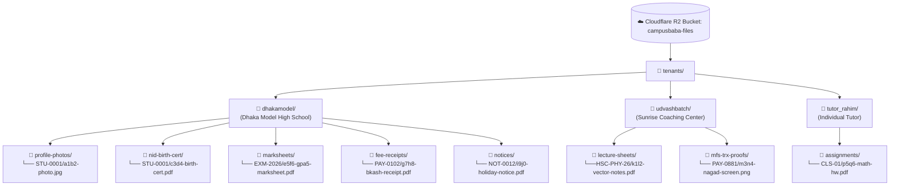

# Cloudflare R2 Free Tier Setup & Multi-Tenant Folder Isolation Guide

> **Do You Need to Manually Create Folders in Cloudflare R2?**
> **No!** You only create **ONE single R2 Bucket** (`campusbaba-files`). In S3/R2 object storage, folders are virtual key prefixes. Our [StorageKeyBuilder.ts](file:///d:/Personal-projects/campusbaba_saas/campusBaba_api/src/domain/storage/StorageKeyBuilder.ts) **automatically creates and isolates each organization's folder hierarchy on the fly** (`tenants/<subdomain>/<module>/<entity_id>/<uuid>-<filename>`) the moment a file is uploaded, and blocks any organization from ever reading or writing outside its own `tenants/<subdomain>/` folder.

---

## 1. Cloudflare R2 Free Tier Allowances & Built-In Guardrails

Cloudflare R2's permanent **Free Tier (Standard Storage)** includes:

| Resource | Free Tier Monthly Limit | CampusBaba Built-In Guardrail ([StorageKeyBuilder.ts](file:///d:/Personal-projects/campusbaba_saas/campusBaba_api/src/domain/storage/StorageKeyBuilder.ts#L10-L16)) |
|---|---|---|
| **Storage Volume** | **10 GB-month** | Automatic platform alerts at **70% (7 GB)** and **90% (9 GB)** + per-organization MB quota cap (`storageLimitMb` in RMS Plans). |
| **Class A Operations** (`PUT`, `POST`, `LIST`) | **1,000,000 / month** | Direct presigned uploads + SHA-256 deduplication prevent redundant writes. |
| **Class B Operations** (`GET`, `HEAD`) | **10,000,000 / month** | Short-lived signed URLs (`300s` TTL) with browser caching. |
| **Egress (Bandwidth)** | **$0.00 (100% Free Unlimited)** | Zero bandwidth cost when students/guardians download PDF marksheets, admit cards, or fee receipts. |

---

## 2. How Multi-Tenant Folder Isolation Works Automatically

You **never** need to log into Cloudflare to create a folder when a new school, coaching center, or tutor registers.

When an organization (e.g., `dhakamodel`, `udvashbatch`, or `tutor_rahim`) uploads a file or generates a PDF marksheet, [StorageKeyBuilder.buildTenantKey(...)](file:///d:/Personal-projects/campusbaba_saas/campusBaba_api/src/domain/storage/StorageKeyBuilder.ts#L79-L93) automatically constructs the isolated folder path:

```text
tenants/{tenant_subdomain}/{module}/{entity_id}/{uuid}-{sanitized_filename}
```

### Visual Folder Structure Inside Your Single `campusbaba-files` Bucket



### Standard Subfolders Automatically Created per Organization (`{module}`)

| Subfolder (`{module}`) | When It Is Created Automatically | Who Can Access It |
|---|---|---|
| `tenants/<org>/profile-photos/` | When a Student, Teacher, or Staff member uploads an avatar (auto EXIF-stripped & capped at 300 KB). | Authenticated users of `<org>`. |
| `tenants/<org>/nid-birth-cert/` | When uploading sensitive Guardian NID or Student Birth Registration PDFs (`isSensitive: true`). | Only `<org>` Admin (`files:sensitive:read`), logged in `audit_logs`. |
| `tenants/<org>/marksheets/` | When generating Bangladesh 5.00 GPA Term Marksheets or Admit Cards. | `<org>` Admin, Teachers, and the specific Student/Guardian. |
| `tenants/<org>/fee-receipts/` | When generating Money Receipts or uploading manual bKash/Nagad Send-Money screenshots. | `<org>` Admin, Accountant, and the Student/Guardian. |
| `tenants/<org>/notices/` | When attaching PDFs/images to a school notice or circular. | All members of `<org>`. |
| `tenants/<org>/exports/` | When SuperAdmin clicks **2. Export Archive** in RMS before offboarding an organization. | SuperAdmin RMS only. |

---

## 3. Step-by-Step: How to Configure Cloudflare R2 Free Tier

### Step 3.1: Create Your Single R2 Bucket in Cloudflare Dashboard
1. Log in to https://dash.cloudflare.com.
2. In the left sidebar, click **R2 Object Storage** $\rightarrow$ **Overview**. *(If this is your first time, activate R2—the first 10 GB/month and all egress are $0.00).*
3. Click **Create bucket**:
   - **Bucket name**: `campusbaba-files`
   - **Location**: Choose **Automatic** (or **Asia-Pacific `APAC`** for lowest latency in Bangladesh).
   - **Default Storage Class**: **Standard** *(Important: always keep Standard storage class—Infrequent Access is not part of the Free Tier).*
4. Click **Create bucket**.

---

### Step 3.2: Configure CORS Policy on the Bucket (For Direct Browser Uploads)
If your frontend uploads directly using presigned URLs, add this CORS rule:
1. Inside your `campusbaba-files` bucket, click the **Settings** tab.
2. Scroll down to **CORS Policy** $\rightarrow$ click **Add CORS policy** and paste:

```json
[
  {
    "AllowedOrigins": [
      "http://localhost:3000",
      "http://localhost:3001",
      "https://campusbaba.com",
      "https://*.campusbaba.com"
    ],
    "AllowedMethods": ["GET", "PUT", "HEAD"],
    "AllowedHeaders": ["Content-Type", "Content-Length", "x-amz-meta-*"],
    "ExposeHeaders": ["ETag"],
    "MaxAgeSeconds": 3600
  }
]
```
3. Click **Save**.

---

### Step 3.3: Configure Lifecycle Rule (Auto-Clean Incomplete Uploads to Save Free Quota)
To ensure failed or abandoned multipart uploads never eat into your 10 GB free tier:
1. Still in the bucket **Settings** tab, scroll to **Object lifecycle rules** $\rightarrow$ **Add rule**.
2. Set **Rule name**: `Abort incomplete multipart uploads`
3. Check **Abort incomplete multipart uploads after** $\rightarrow$ set to **`1` day** $\rightarrow$ click **Add rule**.

---

### Step 3.4: Generate Your R2 S3 API Credentials
1. Go back to **R2 Object Storage $\rightarrow$ Overview**.
2. On the right side, copy your **Account ID** (32-character hex string).
3. Click **Manage R2 API Tokens** (top right) $\rightarrow$ **Create API token**:
   - **Token name**: `campusbaba-api-r2-token`
   - **Permissions**: Select **Object Read & Write**
   - **Specify bucket(s)**: Select **Apply to specific buckets only** $\rightarrow$ choose `campusbaba-files` *(principle of least privilege)*.
   - **TTL**: Forever (or 1 year).
4. Click **Create API Token** and copy these three values from the confirmation screen:
   - **Access Key ID**
   - **Secret Access Key**
   - **S3 Endpoint URL** (`https://<R2_ACCOUNT_ID>.r2.cloudflarestorage.com`)

---

### Step 3.5: Put Your R2 Credentials in `campusBaba_api/.env.local`
Open **[campusBaba_api/.env.local](file:///d:/Personal-projects/campusbaba_saas/campusBaba_api/.env.local#L60-L71)** (Lines 60–71) and update:

```dotenv
# Change STORAGE_DRIVER from 'local' to 'r2':
STORAGE_DRIVER=r2
STORAGE_BUCKET=campusbaba-files
STORAGE_LOCAL_DIR=./.storage
STORAGE_PUBLIC_BASE_URL=
STORAGE_SIGNED_URL_TTL=300
STORAGE_MAX_UPLOAD_MB=10
STORAGE_ALLOWED_MIME=image/jpeg,image/png,image/webp,application/pdf,application/vnd.openxmlformats-officedocument.spreadsheetml.sheet,text/csv

# Paste your Cloudflare R2 credentials here:
R2_ACCOUNT_ID=your_32_char_cloudflare_account_id
R2_ACCESS_KEY_ID=your_r2_access_key_id
R2_SECRET_ACCESS_KEY=your_r2_secret_access_key
R2_BUCKET=campusbaba-files
R2_ENDPOINT=https://your_32_char_cloudflare_account_id.r2.cloudflarestorage.com
```
*(Or update them anytime from the **SuperAdmin RMS UI $\rightarrow$ Settings $\rightarrow$ R2 Storage & Gateways** tab).*

---

## 4. How to Manage, Inspect, or Delete a Single Organization's Folder

| Task | How to Do It |
|---|---|
| **View a single organization's files in Cloudflare Dashboard** | Open Cloudflare Dashboard $\rightarrow$ **R2** $\rightarrow$ `campusbaba-files` $\rightarrow$ click `tenants/` $\rightarrow$ click the organization's subdomain folder (e.g., `dhakamodel/`). |
| **Control an organization's storage limit (MB)** | Open **SuperAdmin RMS $\rightarrow$ Billing** (`/dashboard/billing`) to set the tier's `R2 Storage (MB)` limit (e.g., `500 MB` for Individual Tutor, `2000 MB` for SME Coaching, `5000 MB` for Campus Connect). |
| **Export & Purge a single organization's R2 folder** | In **SuperAdmin RMS $\rightarrow$ Organizations $\rightarrow$ `[org]`**, click **1. Suspend** $\rightarrow$ **2. Export Archive** $\rightarrow$ **3. Verified Purge**. The API calls `storage.deletePrefix("tenants/<subdomain>/")` ([PlatformSaasService.ts](file:///d:/Personal-projects/campusbaba_saas/campusBaba_api/src/application/services/PlatformSaasService.ts#L537-L540)), deleting **only** that organization's folder in R2 while leaving all other schools untouched. |
| **Migrate local dev files (`./.storage`) to Cloudflare R2** | Run our cross-driver migration tool in [tools/storage-migrate/index.ts](file:///d:/Personal-projects/campusbaba_saas/tools/storage-migrate/index.ts), which copies `tenants/<subdomain>/*` from local disk to R2 and verifies SHA-256 checksums. |
