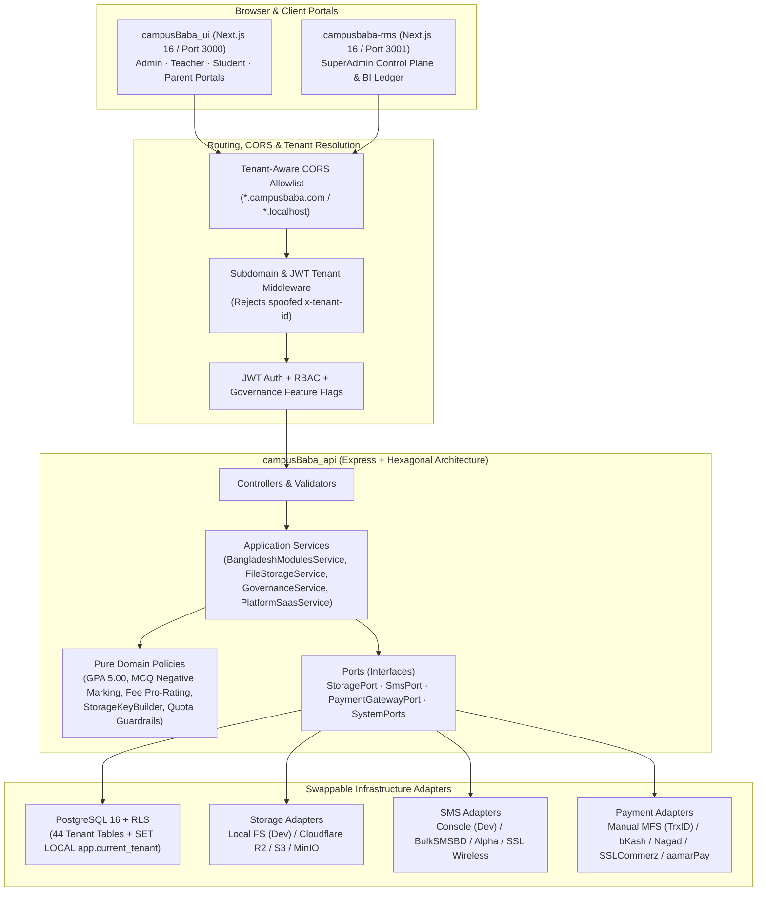
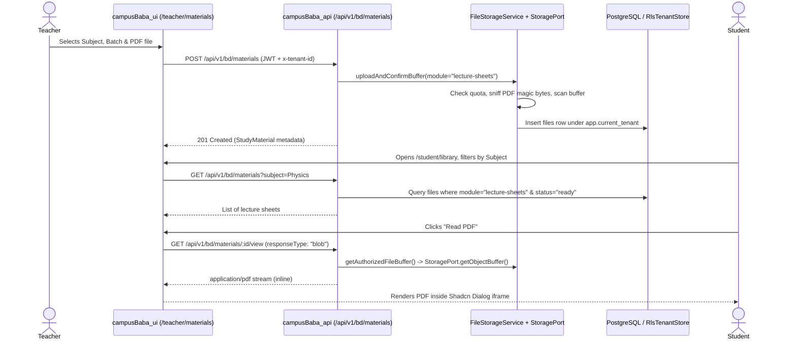

# CampusBaba SaaS — Full-Fledge Architectural Overview

> **Scope**: Complete technical & functional architecture across all three applications in `campusbaba_saas`:
> 1. **`campusBaba_api`** — Multi-Tenant Hexagonal Express/TypeScript API (PostgreSQL 16 + Row-Level Security)
> 2. **`campusBaba_ui`** — Multi-Portal Tenant Web App (Next.js 16, React, Shadcn UI, Tailwind CSS v4, `react-i18next` EN/BN)
> 3. **`campusbaba-rms`** — Platform SuperAdmin Control Plane & Organization BI Ledger (Next.js 16, Shadcn UI)

---

## 1. System Topology & Multi-App Architecture

CampusBaba SaaS is structured as a **single-deployment, multi-tenant B2B2C education platform** designed for Bangladeshi schools, madrasas, and coaching centers. Tenants are isolated at the subdomain, CORS, JWT, storage-prefix, and database Row-Level Security (RLS) layers.

---

## 2. Backend Architecture (`campusBaba_api`) — Hexagonal (Ports & Adapters)

`campusBaba_api` enforces strict **Hexagonal Architecture** boundaries verified automatically by `npm run verify:all` (`scripts/check-env-and-boundaries.ts` and `scripts/verify-rls.ts`).

### 2.1 Layer Responsibilities & Dependency Rules
| Layer | Directory | Responsibilities | Strict Boundary Rules |
| :--- | :--- | :--- | :--- |
| **Config** | `src/config/` | Validates and exports typed environment configuration | **Only** layer allowed to read `process.env` |
| **Domain** | `src/domain/` | Pure business rules: RBAC `Permissions.ts`, `BangladeshGradingPolicy.ts`, `StorageKeyBuilder.ts`, fee pro-rating, BTRC SMS segment math | Zero Express, `pg`, HTTP, or cloud SDK imports |
| **Ports** | `src/ports/` | Contracts: `StoragePort.ts`, `SmsPort.ts`, `PaymentGatewayPort.ts`, `SystemPorts.ts` (`EmailPort`, `PdfPort`, `CachePort`, `QueuePort`, `ScanPort`, `AuditPort`, `SecretsVaultPort`, `IdGeneratorPort`, `ClockPort`) | Pure TypeScript interfaces only |
| **Application** | `src/application/` | Use-case orchestration (`BangladeshModulesService`, `FileStorageService`, `GovernanceService`, `PlatformSaasService`, `InvitationAuthService`) | Depends only on `domain/`, `ports/`, and `RlsTenantStore` |
| **Infrastructure** | `src/infrastructure/` | Concrete adapters for PostgreSQL/RLS, Local FS, Cloudflare R2, S3, MinIO, SMS gateways, MFS/PGW gateways, PDF rendering, AES-256-GCM vault | Implements `ports/` interfaces |
| **Composition** | `src/composition/container.ts` | Wires active drivers from `config` into application services | Single wiring point; supports zero-external-account local mode |
| **HTTP Delivery** | `src/routes/`, `src/controllers/`, `src/middlewares/` | Express routing, request validation, JWT auth, RBAC (`authorize`), feature gating (`requireFeatureFlag`), error handling | Delegates business logic to `container.*` services |

### 2.2 Swappable Infrastructure Drivers
The platform boots in local development with **zero external cloud accounts** (`local` storage, `console` SMS, `manual` payment, `memory` cache/queue) and switches to production drivers via environment configuration:
- **`StoragePort`**: `local-fs.adapter.ts` (dev) ↔ `r2.adapter.ts` (Cloudflare R2) / S3 / MinIO
  - Enforces `tenants/<tenantId>/<module>/<entityId>/<uuid>-<sanitizedName>` key isolation.
  - Rejects path traversal and video uploads on R2 free tier; sniffs magic-byte MIME types; strips JPEG EXIF APP1 metadata; runs `ScanPort` antivirus check; enforces per-tenant storage quotas and 70%/90% platform alerts.
- **`SmsPort`**: `console` (dev) ↔ `bulksmsbd` / `alpha` / `ssl_wireless`
  - Computes GSM-7 (`160` single / `153` multi-part) vs. Bangla Unicode UCS-2 (`70` single / `67` multi-part) segments and enforces BTRC promotional DND/time-window rules.
- **`PaymentGatewayPort`**: `manual` (MFS TrxID) ↔ `bkash` / `nagad` / `sslcommerz` / `aamarpay`
  - Verifies signed webhooks, rejects forged signatures, and supports transaction queries & refunds.

---

## 3. Multi-Tenancy, PostgreSQL 16 & Row-Level Security (RLS)

### 3.1 Request-Level Tenant Isolation
1. **Tenant-Aware CORS (`src/app.ts`)**: `isAllowedCorsOrigin` allows only explicitly configured origins (`CORS_ALLOWED_ORIGINS`), `*.campusbaba.com`, or `*.localhost` in non-production environments.
2. **Host & Token Binding**: Tenant identity is resolved from the request subdomain/host and cross-checked against the authenticated JWT's `tenantId` claim. Forged `x-tenant-id` headers, reserved subdomains, and cross-tenant JWTs are rejected (`400`/`401`/`403`).

### 3.2 Database-Level RLS Isolation
- **Schema (`src/infrastructure/persistence/postgres/migrations/0001_initial_rls_schema.sql` & `src/infrastructure/persistence/postgres/schema.ts`)**:
  - **44 tenant-scoped tables** (`TENANT_RLS_TABLES`) all enforce `tenant_id NOT NULL`, `ENABLE ROW LEVEL SECURITY`, `FORCE ROW LEVEL SECURITY`, and `USING` / `WITH CHECK` policies bound to `current_setting('app.current_tenant', true)`.
- **PgBouncer Transaction-Mode Safety (`src/infrastructure/persistence/postgres/rlsTransaction.ts`)**:
  - Every tenant operation executes inside `RlsTenantStore.runWithTenantContext({ tenantId, actorUserId }, ...)` (`AsyncLocalStorage`), generating `SELECT set_config('app.current_tenant', $1, true);` (`SET LOCAL`) so tenant context never leaks across pooled connections.
  - **Fail-Closed**: Querying or writing without an active `app.current_tenant` returns zero rows and blocks writes.

---

## 4. Security, RBAC & Zero-Code Governance Control Plane

### 4.1 Authentication & Onboarding
- **JWT Access + Refresh Rotation**: Short-lived access tokens paired with rotating refresh tokens.
- **Signed Single-Use Invitations (`/api/v1/auth/invitations`)**: Admins generate QR codes / registration links (`RegisterUserModal.tsx` → `/register/[token]`) bound to `tenantId`, `role`, `email`, and `referenceId`.

### 4.2 Centralized Governance Control Plane
Managed by SuperAdmin (`/api/v1/superadmin/governance/*`) and Tenant Admins (`/api/v1/governance/config`, `/admin/settings`), and consumed live by `campusBaba_ui` via `useGovernance()` (`GET /api/v1/governance/my-config`):
1. **Live Role-Permission Matrix (`src/domain/rbac/Permissions.ts`)**: Granular `PERMISSIONS.*` codes across `admin`, `employee`, `teacher`, `student`, and `parent` roles.
2. **Live Feature Flags**: `coachingBatches`, `library`, `sms`, `onlinePayments`, `transport`, `hostel`, `gpa5Grading`, `madrasaTrack`. Sidebars and API routes (`requireFeatureFlag(...)`) dynamically gate modules per tenant.
3. **Security & Verification Locks**: `allowQrSelfRegistration`, `requireAccountantTrxVerification`, `autoActivateStudentOnPayment`.
4. **AES-256-GCM Encrypted Credentials**: Tenants can store their own bKash, Nagad, SSLCommerz, BulkSMSBD, Alpha SMS, or SSL Wireless keys encrypted at rest via `SecretsVaultPort`.

---

## 5. Core & Bangladesh-Specific Domain Modules

Implemented across `BangladeshModulesService.ts`, `bdModulesController.ts`, and `bdModulesRoutes.ts` (`/api/v1/bd/*`):

| Module | Backend Endpoints | Frontend Routes | Key Capabilities |
| :--- | :--- | :--- | :--- |
| **Subject-Wise PDF Lecture Sheets & Digital Library** | `GET/POST/DELETE /bd/materials`, `GET /bd/materials/:id/view`, `GET/POST /bd/library/books` | `/teacher/materials`, `/admin/library`, `/student/library`, `/parent/library` | Subject/batch tagging, `StoragePort` PDF storage, authorized inline PDF reader (`<iframe>` via Blob URL), download, physical book catalog |
| **Coaching Batches & Waitlist** | `GET/POST /bd/batches`, `POST /bd/batches/:batchId/enroll` | `/admin/batches` | Seat capacity enforcement, automatic waitlisting when full, mid-month pro-rated fee calculation |
| **Online MCQ Practice & Auto-Grading** | `GET/POST /bd/mcq`, `POST /bd/mcq/:quizId/submit`, `GET /bd/mcq/submissions`, `POST /bd/exams/mcq/evaluate` | `/teacher/mcq`, `/student/mcq` | Answer keys stripped for students; instant auto-grading with configurable negative marking (`-0.25` default) |
| **Homework & Assignments** | `GET/POST /bd/assignments`, `POST /bd/assignments/:id/submit` | `/teacher/assignments`, `/student/assignments` | Due-date tracking, instructions, student text/link submissions |
| **Manual MFS (`bKash`/`Nagad`/`Rocket`) TrxID** | `GET /bd/mfs-payments`, `POST /bd/mfs-payments/submit`, `POST /bd/mfs-payments/:paymentId/verify` | `/student/mfs-pay`, `/admin/mfs-payments` | Enforces `UNIQUE (tenant_id, gateway, transaction_id)`, accountant approve/reject, oldest-due-first invoice allocation, audit logging |
| **BTRC SMS Gateway** | `GET /bd/sms/logs`, `POST /bd/sms/send` | `/admin/sms` | Live GSM-7 (`160/153`) vs. Bangla UCS-2 (`70/67`) segment counter, credit checks, promotional DND rules |
| **BD 5.00 GPA & Bangla PDF Marksheets** | `POST /bd/exams/tabulation`, `POST /bd/exams/marksheet-pdf` | `/admin/exams/marks`, `/teacher/exams/marks` | 5.00 GPA scale, 4th-subject bonus, mandatory-subject fail rule (`0.00 F`), merit position ranking, Noto Sans Bengali PDF rendering |

### 5.1 End-to-End PDF Lecture Sheet Flow

---

## 6. Frontend Portals (`campusBaba_ui`)

Built with **Next.js 16 (App Router, Turbopack)**, **React Query (`@tanstack/react-query`)**, **NextAuth**, **Shadcn UI** (`@radix-ui` primitives + Tailwind CSS v4), and **EN/BN bilingual localization** (`src/locales/en.json`, `src/locales/bn.json`).

### 6.1 Portal Structure (57 Compiled Routes)
- **Admin Portal (`/admin/*`)**: `dashboard`, `students`, `teachers`, `employees`, `parents`, `departments`, `courses`, `batches`, `library`, `classrooms`, `attendance`, `routines`, `exams`, `exams/marks`, `payments`, `mfs-payments`, `expenses`, `notices`, `sms`, `reports` (`enrollment`, `income`, `profit-expense`, `projection`), `settings`.
- **Teacher Portal (`/teacher/*`)**: `dashboard`, `routines`, `attendance`, `materials`, `assignments`, `exams`, `exams/marks`, `mcq`, `notices`.
- **Student Portal (`/student/*`)**: `dashboard`, `payments`, `mfs-pay`, `routines`, `attendance`, `library`, `assignments`, `exams`, `exams/marks`, `mcq`.
- **Parent Portal (`/parent/*`)**: `dashboard`, `children`, `payments`, `routines`, `attendance`, `library`, `exams`, `exams/marks`.

### 6.2 UI Component & Modal Standards
- All modals use Shadcn `Dialog` ([dialog.tsx](file:///d:/Personal-projects/campusbaba_saas/campusBaba_ui/src/components/ui/dialog.tsx)), `FormDialog` ([FormDialog.tsx](file:///d:/Personal-projects/campusbaba_saas/campusBaba_ui/src/components/reusable/FormDialog.tsx)), `ConfirmDialog` ([ConfirmDialog.tsx](file:///d:/Personal-projects/campusbaba_saas/campusBaba_ui/src/components/reusable/ConfirmDialog.tsx)), and `InvoiceDialog` ([InvoiceDialog.tsx](file:///d:/Personal-projects/campusbaba_saas/campusBaba_ui/src/components/reusable/InvoiceDialog.tsx)) with `backdrop-blur-[2px]`, `max-h-[90vh]` scroll containment, and keyboard/focus accessibility.
- Theme styling uses Tailwind v4 semantic tokens (`bg-card`, `border-border`, `text-muted-foreground`, `bg-primary`, `ring-ring`) and Shadcn primitives (`Card`, `Table`, `Select`, `Checkbox`, `Textarea`, `Button`, `Badge`, `Tabs`).

---

## 7. Platform Control Plane (`campusbaba-rms`) & Commercial BI

`campusbaba-rms` is the SuperAdmin control plane for managing tenant organizations, quotas, billing plans, and platform-wide business intelligence:
- **Routes (`/dashboard/*`)**: `organizations`, `bi-ledger`, `billing`, `provision`, `notices`, `audit-log`, `settings`.
- **Tiered Plans & Commercial Model (`PlatformSaasService` / `bdArchetypeSeeds.ts`)**:
  - **Individual Tutor**: `1` teacher cap, unlimited (`-1`) students & guardians, `20` classes.
  - **SME Coaching**: `10` teachers, unlimited (`-1`) students & guardians.
  - **Campus Connect**: School/college tier with customizable teacher/class/student quotas.
  - **Per-Student Revenue Split**: `15 BDT` gross per student (`5 BDT` organization retained share + `10 BDT` platform share) with `0 BDT` (free) guardian portal, tracked per organization in `/dashboard/bi-ledger` and `GET /api/v1/superadmin/dashboard-stats`.

---

## 8. Verification & Quality Gates

| App | Command | What It Verifies |
| :--- | :--- | :--- |
| **`campusBaba_api`** | `npm run verify:all && npm run build` | `verify-rls.ts` (44 RLS tables), `check-env-and-boundaries.ts` (Hexagonal + `.env.example` sync), `tests/run-all-tests.ts` (30/30 unit, contract & HTTP integration tests), `tsc` build |
| **`campusBaba_ui`** | `npx tsc --noEmit && npm run build` | TypeScript strict check across all portals/components and Next.js 16 production build (57/57 routes) |
| **`campusbaba-rms`** | `npx tsc --noEmit` | SuperAdmin control plane & BI Ledger TypeScript check |
