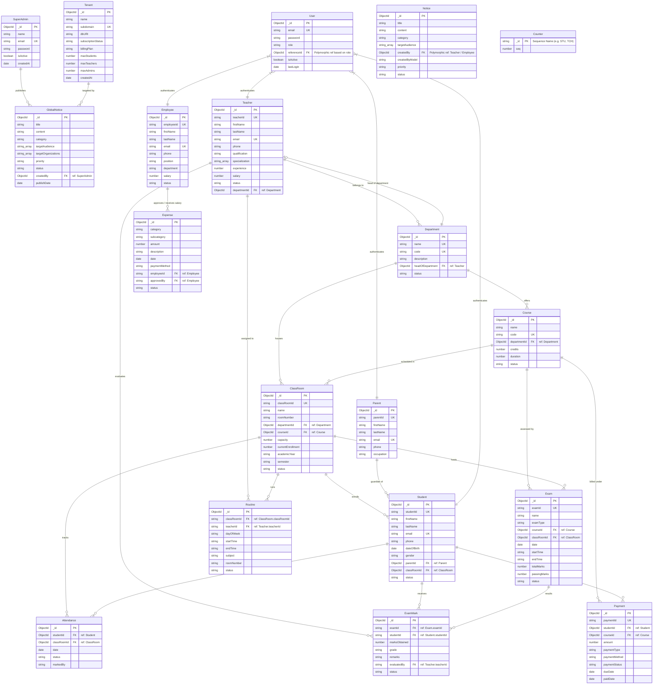

# CampusBaba SaaS - System Architecture, Database ERD & Security Specification

This document provides an end-to-end technical specification for **CampusBaba SaaS**, covering the database schema & ER diagram, full system architecture, security model (RBAC/ABAC, encryption, audit), and scalability/technology justifications.

---

## 📐 1. System Architecture Diagram & Component Descriptions

### 1.1 High-Level Architecture Diagram

```mermaid
flowchart TD
    subgraph Clients["Client Layer"]
        UI["campusBaba_ui\n(Multi-Tenant Institution Portal)\n[Next.js / React]"]
        RMS["campusbaba-rms\n(SuperAdmin Management Portal)\n[Next.js / React]"]
    end

    subgraph EntryPoint["API Gateway & Routing Layer"]
        DNS["DNS / Subdomain Resolver\n(*.campusbaba.com)"]
        CORS["CORS & Security Hardening\n(Helmet, Compression, Body Parser)"]
    end

    subgraph BackendApp["Express Backend Application (campusBaba_api)"]
        Router["Express Router (/api/v1)"]
        
        subgraph MasterRoutes["Master Platform Layer"]
            SuperAdminCtrl["superAdminController\n(Provisioning, Metrics, Notices)"]
        end
        
        subgraph TenantMiddlewareLayer["Tenant Resolution Context"]
            TenantResolver["tenantResolver Middleware\n(Header 'x-tenant-id' / Hostname Subdomain)"]
            ALS["AsyncLocalStorage Context\n(tenantContext.run)"]
        end
        
        subgraph TenantServices["Tenant Operations Layer"]
            ModelProxy["Dynamic Model Proxies\n(Student, Teacher, ClassRoom, Payment, etc.)"]
            Controllers["Domain Controllers\n(studentController, examController, etc.)"]
        end
    end

    subgraph ConnectionManager["Database Management Layer"]
        TCM["TenantConnectionManager\n(Connection Pooling & Schema Registry)"]
    end

    subgraph DataLayer["MongoDB Cluster Layer"]
        MasterDB[(Master DB: schooler\n• SuperAdmin\n• Tenant\n• GlobalNotice)]
        TenantDBA[(Tenant DB: tenant_schoola\n• Users, Students, Teachers\n• Classes, Exams, Payments)]
        TenantDBB[(Tenant DB: tenant_schoolb\n• Users, Students, Teachers\n• Classes, Exams, Payments)]
    end

    %% Client Interactions
    UI -->|Subdomain / Header: x-tenant-id| DNS
    RMS -->|SuperAdmin Auth Token| CORS

    DNS --> CORS
    CORS --> Router

    %% Route Splitting
    Router -->|/api/v1/superadmin| SuperAdminCtrl
    Router -->|/api/v1/* (Tenant APIs)| TenantResolver

    %% Master Operations
    SuperAdminCtrl -->|Manage Tenants & Notices| MasterDB

    %% Tenant Resolution Flow
    TenantResolver -->|Lookup Subdomain & Subscription| MasterDB
    TenantResolver -->|Request Tenant Connection| TCM
    TenantResolver -->|Wrap Request| ALS

    %% Connection Pooling
    TCM -->|Create/Reuse Connection| TenantDBA
    TCM -->|Create/Reuse Connection| TenantDBB

    %% Controller Execution via Proxy
    ALS --> Controllers
    Controllers --> ModelProxy
    ModelProxy -->|Intercept Query & Bind Active Conn| TCM
    ModelProxy -->|Execute Isolated Queries| TenantDBA
    ModelProxy -->|Execute Isolated Queries| TenantDBB
```

---

### 1.2 Component Descriptions

| Component | Technology | Description |
|---|---|---|
| **`campusBaba_ui`** | Next.js, React, TailwindCSS, Axios | Multi-tenant web client used by school admins, teachers, students, and parents. Dynamically attaches tenant context via subdomains and `x-tenant-id` request headers. |
| **`campusbaba-rms`** | Next.js, React, Lucide, Recharts | Platform Management System for SuperAdmins. Handles organization provisioning, subscription monitoring, tenant suspension/activation, and cross-tenant analytics. |
| **`campusBaba_api`** | Node.js, Express, TypeScript | Central application REST API server implementing security controls, request validation, tenant resolution, and data access. |
| **`tenantResolver`** | Express Middleware | Extracts tenant ID from HTTP headers or hostnames, verifies subscription status in Master DB, retrieves tenant DB connection, and establishes async context. |
| **`AsyncLocalStorage`** | Node.js native `async_hooks` | Thread-safe asynchronous context wrapper that carries the active tenant's Mongoose connection throughout the lifecycle of an HTTP request. |
| **`TenantConnectionManager`** | TypeScript Singleton | Caches active Mongoose database connections in memory to prevent connection overhead and registers tenant schemas dynamically. |
| **`Model Proxy Layer`** | ES6 Proxies | Intercepts standard Mongoose model calls (e.g. `Student.find()`) and delegates them to the tenant connection active in `AsyncLocalStorage`. |
| **Master Database (`schooler`)** | MongoDB | Stores platform configuration, tenant credentials, subscription status, and global broadcast notices. |
| **Tenant Databases (`tenant_<subdomain>`)** | MongoDB | Dedicated database instances for each institution containing operational records (students, grades, attendance, billing). |

---

## 📊 2. Entity-Relationship (ER) Diagram & NoSQL Schemas

### 2.1 Complete Mermaid ER Diagram



---

### 2.2 Relational & NoSQL Schema Catalog

#### A. Master Database Collections (`schooler`)

```typescript
// Tenant Schema
{
  _id: ObjectId,
  name: string,
  subdomain: string, // UNIQUE, Indexed
  dbURI: string,
  subscriptionStatus: "active" | "inactive" | "past_due",
  billingPlan: string,
  maxStudents: number,
  maxTeachers: number,
  maxAdmins: number,
  createdAt: Date,
  updatedAt: Date
}

// SuperAdmin Schema
{
  _id: ObjectId,
  name: string,
  email: string, // UNIQUE, Indexed
  password: string, // Hashed via bcrypt (10 salt rounds)
  isActive: boolean,
  createdAt: Date,
  updatedAt: Date
}
```

#### B. Core Tenant Database Collections (`tenant_<subdomain>`)

```typescript
// User Authentication Collection
{
  _id: ObjectId,
  email: string, // UNIQUE per tenant
  password: string, // Bcrypt hash
  role: "admin" | "teacher" | "student" | "parent" | "employee",
  referenceId: ObjectId, // Refers to Student/Teacher/Employee/Parent based on role
  isActive: boolean,
  lastLogin: Date
}

// Student Collection
{
  _id: ObjectId,
  studentId: string, // UNIQUE, e.g. STU-0001
  firstName: string,
  lastName: string,
  email: string, // UNIQUE
  phone: string,
  dateOfBirth: Date,
  gender: "male" | "female" | "other",
  address: { street: string, city: string, state: string, zipCode: string, country: string },
  parentId: ObjectId, // Ref: Parent
  classRoomId: ObjectId, // Ref: ClassRoom
  status: "active" | "inactive" | "graduated" | "suspended",
  emergencyContact: { name: string, relationship: string, phone: string },
  medicalInfo?: { bloodGroup: string, allergies: string[], medications: string[] }
}

// Attendance Collection (Compound Constraint)
{
  _id: ObjectId,
  studentId: ObjectId, // Ref: Student
  classRoomId: ObjectId, // Ref: ClassRoom
  date: Date,
  status: "present" | "absent" | "late" | "excused",
  markedBy: string
}
// INDEX: { studentId: 1, classRoomId: 1, date: 1 } -> UNIQUE (prevents duplicate attendance)

// ExamMark Collection (Compound Constraint)
{
  _id: ObjectId,
  examId: string, // Ref: Exam.examId
  studentId: string, // Ref: Student.studentId
  marksObtained: number,
  grade: string,
  evaluatedBy: string, // Ref: Teacher.teacherId
  status: "pending" | "evaluated" | "published"
}
// INDEX: { examId: 1, studentId: 1 } -> UNIQUE (prevents duplicate grading)
```

---

## 🔒 3. Security Model Documentation

CampusBaba enforces a multi-layered security model combining **Role-Based Access Control (RBAC)**, **Attribute-Based/Contextual Control (ABAC)**, **Data Isolation**, **Encryption**, and **Auditability**.

### 3.1 Role-Based Access Control (RBAC) Matrix

Access permissions are enforced dynamically across endpoints based on user JWT roles:

| Resource / Endpoint | SuperAdmin | School Admin | Teacher | Student | Parent | Employee |
|---|:---:|:---:|:---:|:---:|:---:|:---:|
| **Tenant Provisioning / Suspension** | ✅ | ❌ | ❌ | ❌ | ❌ | ❌ |
| **Global Notice Creation** | ✅ | ❌ | ❌ | ❌ | ❌ | ❌ |
| **Institutional Staff Management** | ❌ | ✅ | ❌ | ❌ | ❌ | ❌ |
| **Classroom / Course Assignment** | ❌ | ✅ | 🛠️ (Read) | 🛠️ (Read) | ❌ | ❌ |
| **Attendance Marking** | ❌ | ✅ | ✅ | ❌ | ❌ | ❌ |
| **Grade Entry & Evaluation** | ❌ | ✅ | ✅ | ❌ | ❌ | ❌ |
| **View Student Report Cards** | ❌ | ✅ | ✅ | ✅ (Own) | ✅ (Child) | ❌ |
| **Fee Invoice Payment** | ❌ | ✅ | ❌ | ✅ (Own) | ✅ (Child) | ❌ |
| **Expense Approval / Payroll** | ❌ | ✅ | ❌ | ❌ | ❌ | ✅ |

---

### 3.2 Attribute-Based & Contextual Security (ABAC)

1. **Subdomain Context Verification**: Requests must provide a matching `subdomain` or `x-tenant-id` header. Cross-tenant request spoofing is impossible as queries are executed exclusively within the connection string assigned to that authenticated tenant.
2. **Subscription Lifecycle Enforcement**: `tenantResolver` automatically checks `tenant.subscriptionStatus`. If a tenant is suspended or past-due, the middleware returns `403 Forbidden`, blocking access across all tenant routes.
3. **Data Boundary Guarantees**: Under the `AsyncLocalStorage` model, developer code does not manually pass `tenantId` in queries (`Student.find({ ... })`). This eliminates human error where a developer forgets to filter by tenant ID.

---

### 3.3 Data Protection & Encryption

- **Encryption in Transit**: All API traffic is mandated over TLS/HTTPS with standard HTTP security headers managed via `helmet()`.
- **Encryption at Rest**: Databases are encrypted using MongoDB AES-256 storage engine encryption.
- **Password Security**: Passwords for both SuperAdmins and Tenant Users are hashed using `bcryptjs` with 10 salt rounds before persistence via Mongoose pre-save middleware hooks. Plaintext passwords are never logged or stored.
- **JWT Token Security**: Authenticated sessions issue signed JSON Web Tokens (JWT) using `env.JWT_SECRET` with configurable expiration limits (`JWT_EXPIRES_IN`).

---

### 3.4 Auditability & Compliance

- **Operational Logging**: All incoming HTTP traffic is logged via `morgan` middleware in JSON structured formats.
- **RMS Audit Logs**: Platform-level administrative actions (tenant provisioning, subscription status changes, global notices) are tracked and displayed in the RMS Audit Portal (`campusbaba-rms/src/app/dashboard/audit-log`).
- **Data Privacy Compliance**: Separate tenant databases ensure compliance with international data privacy regulations (FERPA, GDPR), allowing easy compliance with data deletion or data export requests per institution without affecting other tenants.

---

## 🚀 4. Scalability & Technology Justifications

### 4.1 Database-Per-Tenant vs. Shared Database Architecture

| Criteria | Shared DB with `tenant_id` Column | Database-Per-Tenant (CampusBaba Choice) | Justification |
|---|---|---|---|
| **Data Isolation** | Logical (Risk of query leaks if `tenant_id` filter is forgotten) | **Physical Isolation** (Separate MongoDB DB per school) | **Zero Leakage Risk**: Essential for educational & financial compliance. |
| **Performance Isolation** | High risk of "noisy neighbors" degrading other institutions | **Isolated Query Performance** | A large school running complex exam mark reports cannot slow down database operations for another school. |
| **Backup & Restoration** | Complex row-level restoration required | **Granular Backup/Restore** | Individual school databases can be backed up, restored, or exported independently. |
| **Custom Database Scale** | All tenants bound to single DB limits | **Scalable Placement** | High-volume tenants can be placed on dedicated MongoDB clusters by updating `dbURI`. |

---

### 4.2 Why MongoDB (NoSQL)?

1. **Flexible Schema Evolution**: Different schools often require distinct grading systems, medical profiles, or custom exam types. MongoDB document models accommodate schema updates without expensive relational table locks or migrations.
2. **High Write Throughput**: Marking attendance for thousands of students simultaneously or bulk-evaluating exam scores requires high document insert/update speed.
3. **Polymorphic Reference Support**: Cleanly supports polymorphic relationships such as `User.referenceId` linking to `Student`, `Teacher`, `Employee`, or `Parent`, and `Notice.createdBy` linking to `Teacher` or `Employee`.

---

### 4.3 AsyncLocalStorage + Proxy Pattern Justification

- **Standardized Developer Experience**: Developers write standard, clean Mongoose queries (`await Student.find()`) without needing to manually pass connection parameters or database client instances through every layer of code.
- **Automatic Connection Caching**: `TenantConnectionManager` maintains an in-memory dictionary of open Mongoose connections, eliminating the latency of opening a new database socket on every HTTP request.
- **Stateless Backend Horizontal Scaling**: The API backend (`campusBaba_api`) maintains zero local session state. Express instances can be horizontally scaled behind an AWS ALB / NGINX load balancer seamlessly.
