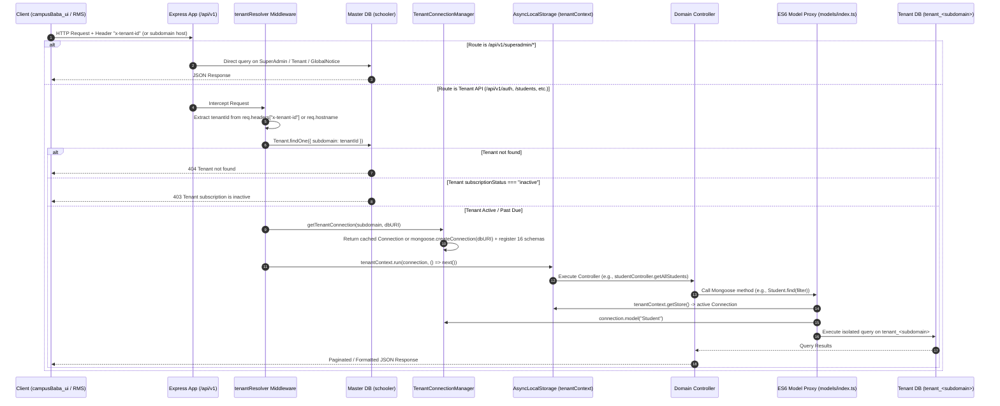
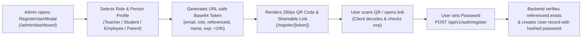

# CampusBaba SaaS — Complete Architecture Pipeline, Features & Operations Specification

This document provides an exhaustive, code-level technical specification of the **CampusBaba SaaS** codebase (`d:/Personal-projects/campusbaba_saas`), covering the end-to-end multi-tenant architecture pipeline, database schemas, authentication & security flows, portal features, and operational workflows.

---

## 1. Executive Overview & Monorepo Topology

**CampusBaba SaaS** (internally also referred to as **Schooler**) is a multi-tenant, database-per-tenant Education & Institution Management SaaS platform built with TypeScript, Node.js/Express, MongoDB/Mongoose, and Next.js (App Router).

### 1.1 Workspace Structure

| Project Directory                                                                          | Package Name     | Default Port    | Tech Stack                                                                                                                       | Purpose                                                                                                                                                                  |
| :----------------------------------------------------------------------------------------- | :--------------- | :-------------- | :------------------------------------------------------------------------------------------------------------------------------- | :----------------------------------------------------------------------------------------------------------------------------------------------------------------------- |
| [campusBaba_api](file:///d:/Personal-projects/campusbaba_saas/campusBaba_api/package.json) | `schooler_api`   | `5001` / `5002` | Express 4, Mongoose 8, TypeScript, Zod, JWT, Bcryptjs                                                                            | Central multi-tenant REST API server handling both Master platform operations and isolated Tenant operations.                                                            |
| [campusBaba_ui](file:///d:/Personal-projects/campusbaba_saas/campusBaba_ui/package.json)   | `schooler_ui`    | `3000`          | Next.js 16 (React 19), NextAuth v4, TanStack Query v5, TanStack Table v8, TailwindCSS v4, Recharts, i18next, jsPDF, XLSX, QRCode | Multi-role Institution Portal serving **Admins**, **Employees**, **Teachers**, **Students**, and **Parents** with English/Bengali (`en`/`bn`) localization.              |
| [campusbaba-rms](file:///d:/Personal-projects/campusbaba_saas/campusbaba-rms/package.json) | `campusbaba-rms` | `3000` / `3001` | Next.js 16 (React 19), TailwindCSS v4, Recharts, Radix UI / Shadcn, Axios, Sonner                                                | SuperAdmin Resource Management System (RMS) for provisioning schools, managing tenant quotas/subscriptions, broadcasting global notices, and viewing platform analytics. |

---

## 2. End-to-End Architecture Pipeline

### 2.1 Multi-Tenant Request Lifecycle & Data Isolation Pipeline

CampusBaba uses a **Physical Database-Per-Tenant** architecture on MongoDB, orchestrated dynamically at runtime using **Node.js `AsyncLocalStorage`** and **ES6 `Proxy` objects**.

### 2.2 Core Pipeline Stages in Detail

#### Stage 1: Client-Side Tenant Identification

- In [axios.ts](file:///d:/Personal-projects/campusbaba_saas/campusBaba_ui/src/lib/axios.ts#L11-L35) and [auth.ts](file:///d:/Personal-projects/campusbaba_saas/campusBaba_ui/src/lib/auth.ts#L25-L32), `campusBaba_ui` resolves the active tenant identifier using a two-step fallback:
  1. Environment variable `process.env.NEXT_PUBLIC_TENANT_ID`.
  2. Subdomain extraction from `window.location.hostname` (or `req.headers.host` during SSR login) when the hostname has $\ge 3$ dot-separated parts (e.g., `dhakapublic.campusbaba.com` $\rightarrow$ `dhakapublic`).
- The resolved tenant ID is injected into every outgoing HTTP request as the `x-tenant-id` header, alongside `Authorization: Bearer <accessToken>`.

#### Stage 2: Express Gateway & Route Splitting

- [app.ts](file:///d:/Personal-projects/campusbaba_saas/campusBaba_api/src/app.ts#L10-L57) initializes the Express pipeline:
  1. `helmet()` for HTTP security headers.
  2. `cors()` allowing credentials (restricted to `https://campusbaba.onrender.com` in production, open in development).
  3. `compression()` for payload gzip compression.
  4. `express.json({ limit: "10mb" })` & `express.urlencoded({ limit: "10mb" })`.
  5. `morgan()` request logging (`dev` in development, `combined` in production).
  6. `GET /health` liveness probe.
  7. Mounts main router at `/api/v1` ([routes/index.ts](file:///d:/Personal-projects/campusbaba_saas/campusBaba_api/src/routes/index.ts#L22-L47)).
- Inside [routes/index.ts](file:///d:/Personal-projects/campusbaba_saas/campusBaba_api/src/routes/index.ts#L24-L28):
  - `/api/v1/superadmin` is mounted **before** `tenantResolver`, operating directly against the default Mongoose connection (Master DB).
  - `router.use(tenantResolver)` gates all 16 downstream tenant route modules.

#### Stage 3: Tenant Resolution & Subscription Gatekeeper

- [tenantResolver.ts](file:///d:/Personal-projects/campusbaba_saas/campusBaba_api/src/middlewares/tenantResolver.ts#L15-L79):
  1. Reads `req.headers["x-tenant-id"]` or parses `req.hostname.split('.')[0]`. Returns `400 Bad Request` if missing.
  2. Queries the Master DB (`Tenant.findOne({ subdomain: tenantId })`). Returns `404 Not Found` if unknown.
  3. Checks `tenant.subscriptionStatus === "inactive"`. If inactive (suspended), immediately halts the request with `403 Forbidden`.
  4. Obtains the tenant's isolated Mongoose `Connection` from [TenantConnectionManager.ts](file:///d:/Personal-projects/campusbaba_saas/campusBaba_api/src/utils/TenantConnectionManager.ts#L15-L42).
  5. Attaches `req.tenantConnection` and `req.tenant` (used by controllers to enforce quota limits like `req.tenant.maxStudents` and `req.tenant.maxTeachers`).
  6. Wraps `next()` inside `tenantContext.run(connection, () => next())` using Node's `AsyncLocalStorage` ([asyncLocalStorage.ts](file:///d:/Personal-projects/campusbaba_saas/campusBaba_api/src/utils/asyncLocalStorage.ts#L1-L4)).

#### Stage 4: Connection Pooling & Dynamic Model Proxy Interception

- **Connection Pooling ([TenantConnectionManager.ts](file:///d:/Personal-projects/campusbaba_saas/campusBaba_api/src/utils/TenantConnectionManager.ts#L4-L47))**:
  - Maintains a singleton dictionary `tenantConnections: { [tenantId: string]: Connection }`.
  - When a tenant connects for the first time, it calls `mongoose.createConnection(uri)` and registers all 16 tenant schemas (`Counter`, `Attendance`, `ClassRoom`, `Course`, `Department`, `Employee`, `Exam`, `ExamMark`, `Expense`, `Notice`, `Parent`, `Payment`, `Routine`, `Student`, `Teacher`, `User`) onto that connection. Subsequent requests reuse the cached connection pool.
- **Model Proxy Layer ([models/index.ts](file:///d:/Personal-projects/campusbaba_saas/campusBaba_api/src/models/index.ts#L22-L56))**:
  - Every exported model (`Student`, `Teacher`, `Payment`, etc.) is created via `createModelProxy<T>(modelName)`.
  - When a controller invokes `Student.find(...)` or `Student.create(...)`, the ES6 `Proxy` `get` trap intercepts property access, fetches the active `Connection` from `tenantContext.getStore()`, retrieves `connection.model(modelName)`, and binds function calls to that tenant-specific Mongoose model.
  - If any code attempts to query a tenant model outside `tenantResolver`, the proxy throws: `"Tenant context not found for model <modelName>. Make sure the request passed through tenantResolver."`

---

## 3. Database Architecture, Schemas & Auto-Sequencing

### 3.1 Master Database (`schooler`)

Connected at server startup in [database.ts](file:///d:/Personal-projects/campusbaba_saas/campusBaba_api/src/config/database.ts#L6-L44). Automatically seeds a default SuperAdmin (`admin@campusbaba.com` / `password123`) if not present.

| Model              | File                                                                                                            | Key Fields & Indexes                                                                                                                                                                                            | Purpose                                                                                          |
| :----------------- | :-------------------------------------------------------------------------------------------------------------- | :-------------------------------------------------------------------------------------------------------------------------------------------------------------------------------------------------------------- | :----------------------------------------------------------------------------------------------- |
| **`SuperAdmin`**   | [SuperAdmin.ts](file:///d:/Personal-projects/campusbaba_saas/campusBaba_api/src/masterModels/SuperAdmin.ts)     | `name`, `email` (unique), `password` (bcrypt 10 rounds via `pre("save")`), `isActive`                                                                                                                           | Platform owner credentials with `comparePassword()` instance method.                             |
| **`Tenant`**       | [Tenant.ts](file:///d:/Personal-projects/campusbaba_saas/campusBaba_api/src/masterModels/Tenant.ts)             | `name`, `subdomain` (unique, indexed), `dbURI`, `subscriptionStatus` (`active` \| `inactive` \| `past_due`), `billingPlan` (`postpaid` default), `maxStudents` (`100`), `maxTeachers` (`10`), `maxAdmins` (`3`) | Registry of provisioned institutions, their dedicated MongoDB database URI, and capacity quotas. |
| **`GlobalNotice`** | [GlobalNotice.ts](file:///d:/Personal-projects/campusbaba_saas/campusBaba_api/src/masterModels/GlobalNotice.ts) | `title`, `content`, `category`, `targetAudience[]`, `targetOrganizations[]` (`["all"]` or tenant IDs), `priority`, `status`, `publishDate`, `expiryDate`, `createdBy` (ref: `SuperAdmin`)                       | Platform-wide announcements broadcast by SuperAdmins.                                            |

### 3.2 Tenant Database (`tenant_<subdomain>`)

Each provisioned school gets its own database (`tenant_<subdomain>`) with 16 collections:

| Collection / Model | File                                                                                                  | Auto-ID Prefix             | Key Relationships, Constraints & Indexes                                                                                                                                                                                                                                                                                                                                                            |
| :----------------- | :---------------------------------------------------------------------------------------------------- | :------------------------- | :-------------------------------------------------------------------------------------------------------------------------------------------------------------------------------------------------------------------------------------------------------------------------------------------------------------------------------------------------------------------------------------------------- |
| **`Counter`**      | [Counter.ts](file:///d:/Personal-projects/campusbaba_saas/campusBaba_api/src/models/Counter.ts)       | N/A                        | `_id` (sequence name: `"student"`, `"teacher"`, `"parent"`, `"employee"`, `"classroom"`, `"payment"`), `seq` (number). Used by `nextSequence()` in [models/index.ts](file:///d:/Personal-projects/campusbaba_saas/campusBaba_api/src/models/index.ts#L58-L65).                                                                                                                                      |
| **`User`**         | [User.ts](file:///d:/Personal-projects/campusbaba_saas/campusBaba_api/src/models/User.ts)             | ObjectId                   | `email` (unique), `password` (bcrypt hashed), `role` (`admin` \| `teacher` \| `student` \| `parent` \| `employee`), `referenceId` (polymorphic `refPath: "role"`), `isActive`, `lastLogin`.                                                                                                                                                                                                         |
| **`Student`**      | [Student.ts](file:///d:/Personal-projects/campusbaba_saas/campusBaba_api/src/models/Student.ts)       | `STU-0001`                 | `studentId` (unique, sparse), `firstName`, `lastName`, `email` (unique), `phone`, `dateOfBirth`, `gender`, `address`, `parentId` (ref: `Parent`), `classRoomId` (ref: `ClassRoom`), `status` (`active` \| `inactive` \| `graduated` \| `suspended`), `emergencyContact`, `medicalInfo`.                                                                                                             |
| **`Teacher`**      | [Teacher.ts](file:///d:/Personal-projects/campusbaba_saas/campusBaba_api/src/models/Teacher.ts)       | `TCH-0001`                 | `teacherId` (unique, sparse), `firstName`, `lastName`, `email` (unique), `qualification`, `specialization[]`, `experience`, `salary`, `status` (`active` \| `inactive` \| `on-leave`), `departmentId` (ref: `Department`), `emergencyContact`.                                                                                                                                                      |
| **`Parent`**       | [Parent.ts](file:///d:/Personal-projects/campusbaba_saas/campusBaba_api/src/models/Parent.ts)         | `PAR-0001`                 | `parentId` (unique, sparse), `firstName`, `lastName`, `email` (unique), `phone`, `occupation`, `address`, `relationship` (`father` \| `mother` \| `guardian`).                                                                                                                                                                                                                                      |
| **`Employee`**     | [Employee.ts](file:///d:/Personal-projects/campusbaba_saas/campusBaba_api/src/models/Employee.ts)     | `EMP-0001` (or `ADM-<ts>`) | `employeeId` (unique, sparse), `firstName`, `lastName`, `email` (unique), `position`, `department`, `salary`, `status` (`active` \| `inactive` \| `on-leave`), `emergencyContact`. Also backs `admin` role profiles.                                                                                                                                                                                |
| **`Department`**   | [Department.ts](file:///d:/Personal-projects/campusbaba_saas/campusBaba_api/src/models/Department.ts) | ObjectId                   | `name` (unique), `code` (unique, uppercase), `description`, `headOfDepartment` (ref: `Teacher`), `status` (`active` \| `inactive`).                                                                                                                                                                                                                                                                 |
| **`Course`**       | [Course.ts](file:///d:/Personal-projects/campusbaba_saas/campusBaba_api/src/models/Course.ts)         | ObjectId                   | `name`, `code` (unique, uppercase), `departmentId` (ref: `Department`), `credits`, `duration` (months), `status` (`active` \| `inactive`).                                                                                                                                                                                                                                                          |
| **`ClassRoom`**    | [ClassRoom.ts](file:///d:/Personal-projects/campusbaba_saas/campusBaba_api/src/models/ClassRoom.ts)   | `CR-0001`                  | `classRoomId` (unique), `name`, `roomNumber`, `departmentId` (ref: `Department`), `courseId` (ref: `Course`), `capacity`, `currentEnrollment`, `academicYear`, `semester`, `status` (`active` \| `inactive` \| `completed`).                                                                                                                                                                        |
| **`Attendance`**   | [Attendance.ts](file:///d:/Personal-projects/campusbaba_saas/campusBaba_api/src/models/Attendance.ts) | ObjectId                   | `studentId` (ref: `Student`), `classRoomId` (ref: `ClassRoom`), `date`, `status` (`present` \| `absent` \| `late` \| `excused`), `remarks`, `markedBy`. **Unique Compound Index**: `{ studentId: 1, classRoomId: 1, date: 1 }`.                                                                                                                                                                     |
| **`Routine`**      | [Routine.ts](file:///d:/Personal-projects/campusbaba_saas/campusBaba_api/src/models/Routine.ts)       | ObjectId                   | `classRoomId` (ref: `ClassRoom`), `teacherId` (ref: `Teacher`), `dayOfWeek` (`monday`..`sunday`), `startTime` (`HH:MM`), `endTime` (`HH:MM`), `subject`, `roomNumber`, `status` (`active` \| `cancelled` \| `rescheduled`).                                                                                                                                                                         |
| **`Exam`**         | [Exam.ts](file:///d:/Personal-projects/campusbaba_saas/campusBaba_api/src/models/Exam.ts)             | Custom `examId`            | `examId` (unique), `name`, `examType` (`midterm` \| `final` \| `quiz` \| `assignment` \| `practical`), `courseId` (ref: `Course`), `classRoomId` (ref: `ClassRoom`), `date`, `startTime`, `endTime`, `totalMarks`, `passingMarks`, `instructions`, `status` (`scheduled` \| `ongoing` \| `completed` \| `cancelled`).                                                                               |
| **`ExamMark`**     | [ExamMark.ts](file:///d:/Personal-projects/campusbaba_saas/campusBaba_api/src/models/ExamMark.ts)     | ObjectId                   | `examId` (ref: `Exam`), `studentId` (ref: `Student`), `marksObtained`, `grade`, `remarks`, `evaluatedBy` (ref: `Teacher`), `evaluatedAt`, `status` (`pending` \| `evaluated` \| `published`). **Unique Compound Index**: `{ examId: 1, studentId: 1 }`.                                                                                                                                             |
| **`Payment`**      | [Payment.ts](file:///d:/Personal-projects/campusbaba_saas/campusBaba_api/src/models/Payment.ts)       | `PAY-0001`                 | `paymentId` (unique, sparse), `studentId` (ref: `Student`), `courseId` (ref: `Course`), `amount`, `paymentType` (`tuition` \| `exam` \| `library` \| `transport` \| `hostel` \| `other`), `paymentMethod` (`cash` \| `card` \| `bank-transfer` \| `online`), `transactionId`, `dueDate`, `paidDate`, `paymentStatus` (`pending` \| `paid` \| `overdue` \| `cancelled`), `academicYear`, `semester`. |
| **`Expense`**      | [Expense.ts](file:///d:/Personal-projects/campusbaba_saas/campusBaba_api/src/models/Expense.ts)       | ObjectId                   | `category` (`salary` \| `fixed` \| `other`), `subcategory`, `amount`, `description`, `date`, `paymentMethod` (`cash` \| `card` \| `bank-transfer` \| `cheque`), `employeeId` (refPath: `employeeModel`), `approvedBy` (ref: `Employee`), `status` (`pending` \| `approved` \| `paid` \| `rejected`).                                                                                                |
| **`Notice`**       | [Notice.ts](file:///d:/Personal-projects/campusbaba_saas/campusBaba_api/src/models/Notice.ts)         | ObjectId                   | `title`, `content`, `category` (`general` \| `academic` \| `exam` \| `event` \| `holiday` \| `urgent`), `targetAudience[]`, `publishDate`, `expiryDate`, `createdBy` (`refPath: "createdByModel"` $\rightarrow$ `Teacher` \| `Employee`), `modifiedBy` (`refPath: "modifiedByModel"`), `status` (`draft` \| `published` \| `archived`), `priority` (`low` \| `medium` \| `high`).                   |

---

## 4. Authentication, Security & Onboarding Pipelines

### 4.1 Dual Authentication Architecture

1. **SuperAdmin Authentication (`campusbaba-rms`)**:
   - **Endpoint**: `POST /api/v1/superadmin/login` ([superAdminController.ts](file:///d:/Personal-projects/campusbaba_saas/campusBaba_api/src/controllers/superAdminController.ts#L12-L48)).
   - Verifies email/password against `SuperAdmin` collection in Master DB, checks `admin.isActive`, and signs a JWT `{ id: admin._id, role: "superadmin" }`.
   - Stored in browser `localStorage` under `"superadmin_token"` ([api.ts](file:///d:/Personal-projects/campusbaba_saas/campusbaba-rms/src/lib/api.ts#L11-L33)). Any `401` response automatically clears the token and redirects to `/`.

2. **Tenant User Authentication (`campusBaba_ui`)**:
   - **NextAuth Credentials Provider** ([auth.ts](file:///d:/Personal-projects/campusbaba_saas/campusBaba_ui/src/lib/auth.ts#L12-L113)) sends `POST /api/v1/auth/login` with `x-tenant-id`.
   - [authController.ts](file:///d:/Personal-projects/campusbaba_saas/campusBaba_api/src/controllers/authController.ts#L16-L109) verifies the `User` record in the active tenant database, updates `lastLogin`, resolves the polymorphic profile (`Teacher`, `Student`, `Parent`, or `Employee` for both `employee` and `admin` roles), and returns a signed JWT (`7d` expiry) plus profile metadata.
   - **Edge Route Protection** ([middleware.ts](file:///d:/Personal-projects/campusbaba_saas/campusBaba_ui/src/middleware.ts#L1-L64)):
     - Uses `withAuth` from `next-auth/middleware` across all routes except `/login`, `/register/*`, `/api/*`, and static assets.
     - Enforces strict role-based URL prefix isolation (`ROLE_PREFIX` & `ROLE_HOME`):

| User Role  | Allowed URL Prefix | Default Home Dashboard | Profile Backing Collection |
| :--------- | :----------------- | :--------------------- | :------------------------- |
| `admin`    | `/admin/*`         | `/admin/dashboard`     | `Employee`                 |
| `employee` | `/admin/*`         | `/admin/dashboard`     | `Employee`                 |
| `teacher`  | `/teacher/*`       | `/teacher/dashboard`   | `Teacher`                  |
| `student`  | `/student/*`       | `/student/dashboard`   | `Student`                  |
| `parent`   | `/parent/*`        | `/parent/dashboard`    | `Parent`                   |

### 4.2 QR Code & Token Self-Registration Pipeline

CampusBaba includes a 2-step passwordless invitation flow allowing school admins to onboard existing staff, teachers, students, or parents without setting their passwords manually:

- **Step 1 (Admin Generation)**: In [RegisterUserModal.tsx](file:///d:/Personal-projects/campusbaba_saas/campusBaba_ui/src/components/reusable/RegisterUserModal.tsx#L43-L147), the admin picks a role (`teacher`, `student`, `employee`, `parent`) and selects an existing profile from the tenant database. `buildToken()` encodes `{ email, role, referenceId, name, exp: Date.now() + 86400000 }` as URL-safe Base64 and renders a downloadable PNG QR code and copyable link `${baseUrl}/register/${token}`.
- **Step 2 (User Activation)**: In [register/[token]/page.tsx](file:///d:/Personal-projects/campusbaba_saas/campusBaba_ui/src/app/register/%5Btoken%5D/page.tsx#L20-L102), the page decodes the Base64 token, validates that `Date.now() <= data.exp`, displays the user's name, email, and role badge, and submits `{ email, password, role, referenceId }` to `POST /api/v1/auth/register`.

### 4.3 Request Validation & Error Handling Pipeline

- **Zod Validation Middleware** ([validateRequest.ts](file:///d:/Personal-projects/campusbaba_saas/campusBaba_api/src/middlewares/validateRequest.ts#L4-L26)): Validates `{ body, query, params }` against domain-specific Zod schemas in [src/validators/](file:///d:/Personal-projects/campusbaba_saas/campusBaba_api/src/validators/index.ts). Returns structured `400 Bad Request` with field-level `path` and `message` arrays on failure.
- **Centralized Error Handling** ([errorHandler.ts](file:///d:/Personal-projects/campusbaba_saas/campusBaba_api/src/middlewares/errorHandler.ts#L3-L46)): Operational errors use `AppError(statusCode, message)` caught via `asyncHandler` wrapper ([asyncHandler.ts](file:///d:/Personal-projects/campusbaba_saas/campusBaba_api/src/middlewares/asyncHandler.ts)).

---

## 5. Comprehensive Feature Catalog Across All Portals

### 5.1 SuperAdmin Portal (`campusbaba-rms`)

Located in [campusbaba-rms/src/app/dashboard/](file:///d:/Personal-projects/campusbaba_saas/campusbaba-rms/src/app/dashboard/layout.tsx):

1. **Executive Dashboard** ([dashboard/page.tsx](file:///d:/Personal-projects/campusbaba_saas/campusbaba-rms/src/app/dashboard/page.tsx)):
   - 6 animated KPI cards: Total Organizations, Registered Subdomains, Active Tenants (with active rate %), Total Student Capacity, Total Teacher Capacity, and Estimated Monthly Recurring Revenue (MRR).
   - Interactive Recharts visualizations: 6-month Revenue vs. Target AreaChart, Organization Registration Growth BarChart, Subscription Status PieChart (`active`, `inactive`, `past_due`), Top 5 Organizations by Student/Teacher Capacity horizontal BarChart, Recent Provisioning Activity feed, and Quick Action shortcuts.
2. **Tenant Provisioning Engine** ([dashboard/provision/page.tsx](file:///d:/Personal-projects/campusbaba_saas/campusbaba-rms/src/app/dashboard/provision/page.tsx) & [superAdminController.ts](file:///d:/Personal-projects/campusbaba_saas/campusBaba_api/src/controllers/superAdminController.ts#L51-L136)):
   - Automated onboarding form taking Organization Name, sanitized alphanumeric Subdomain (`*.campusbaba.com`), Initial Admin Email & Password, and initial `maxStudents` / `maxTeachers` quotas.
   - **Backend Provisioning Pipeline**:
     1. Verifies subdomain uniqueness in Master DB.
     2. Parses `env.MONGODB_URI` and rewrites the database path to `tenant_${subdomain}`.
     3. Creates the `Tenant` document in Master DB.
     4. Opens a new Mongoose connection to `tenant_${subdomain}`, registers all 16 tenant schemas, creates a default Principal `Employee` record (`ADM-<timestamp>`), and creates an initial `admin` `User` linked to that employee.
3. **Organizations Registry & Lifecycle Control** ([dashboard/organizations/page.tsx](file:///d:/Personal-projects/campusbaba_saas/campusbaba-rms/src/app/dashboard/organizations/page.tsx)):
   - Debounced search (by name, subdomain, or ID) + filters by Status (`active`, `inactive`, `past_due`) and Plan (`postpaid`, `prepaid`, `enterprise`).
   - One-click **Suspend** (`subscriptionStatus = "inactive"`), **Activate** (`subscriptionStatus = "active"`), **Delete**, and **Visit Subdomain** actions with confirmation dialogs.
4. **Deep Organization Inspection & Quota Editor** ([dashboard/organizations/[id]/page.tsx](file:///d:/Personal-projects/campusbaba_saas/campusbaba-rms/src/app/dashboard/organizations/%5Bid%5D/page.tsx)):
   - Connects directly to the target tenant's MongoDB instance via `GET /api/v1/superadmin/tenants/:id/details` to compute live utilization progress bars: Current Students vs. `maxStudents`, Current Teachers vs. `maxTeachers`, and Current Employees vs. `maxAdmins`.
   - Inline **Quota Configuration Editor** (`PUT /api/v1/superadmin/tenants/:id`) to dynamically raise/lower `maxStudents`, `maxTeachers`, `maxAdmins`, or switch `billingPlan`.
   - Tabbed member directory inspecting live Students, Teachers, and Employees inside that tenant's database.
5. **Global Notices Broadcast** ([dashboard/notices/page.tsx](file:///d:/Personal-projects/campusbaba_saas/campusbaba-rms/src/app/dashboard/notices/page.tsx)):
   - Create, filter, and delete platform-wide notices categorized by `general`, `academic`, `exam`, `event`, `holiday`, or `urgent`, targeting specific roles (`student`, `teacher`, `employee`, `parent`, `all`) and either all organizations or a selected subset of organizations.
6. **Billing & Plans Overview** ([dashboard/billing/page.tsx](file:///d:/Personal-projects/campusbaba_saas/campusbaba-rms/src/app/dashboard/billing/page.tsx)):
   - Calculates MRR, ARR, and Avg Revenue/Org based on plan tiers (`postpaid`: ৳5,000, `prepaid`: ৳4,500, `enterprise`: ৳15,000) with Revenue vs. Expenses bar charts and plan distribution pie charts.
7. **Audit Log & Platform Settings** ([dashboard/audit-log/page.tsx](file:///d:/Personal-projects/campusbaba_saas/campusbaba-rms/src/app/dashboard/audit-log/page.tsx), [dashboard/settings/page.tsx](file:///d:/Personal-projects/campusbaba_saas/campusbaba-rms/src/app/dashboard/settings/page.tsx)):
   - Activity timeline filterable by category (`org`, `notice`, `auth`, `settings`) and platform settings for profile, security, default tenant quotas, and light/dark theme switching.

---

### 5.2 Multi-Role Institution Portal (`campusBaba_ui`)

#### A. Shared Portal Capabilities

- **Bilingual Localization (i18n)**: Powered by `i18next` ([i18n.ts](file:///d:/Personal-projects/campusbaba_saas/campusBaba_ui/src/lib/i18n.ts)) with full English ([en.json](file:///d:/Personal-projects/campusbaba_saas/campusBaba_ui/src/locales/en.json)) and Bengali ([bn.json](file:///d:/Personal-projects/campusbaba_saas/campusBaba_ui/src/locales/bn.json)) translations, switchable live from the top [Header.tsx](file:///d:/Personal-projects/campusbaba_saas/campusBaba_ui/src/components/layout/Header.tsx#L57-L80) toggle (`EN` / `বাং`).
- **Live Notice Bell Popover**: Displays active published notices filtered by the logged-in user's role (`GET /api/v1/notices/active`) with priority badges and expandable content ([Header.tsx](file:///d:/Personal-projects/campusbaba_saas/campusBaba_ui/src/components/layout/Header.tsx#L83-L154)).
- **Reusable Data Table & Dialog System**: Standardized client/server pagination, sorting, search, `FormDialog`, `FormCombobox`, and `ConfirmDialog` components.

#### B. Admin & Employee Portal (`/admin/*`)

1. **Admin Dashboard** ([admin/dashboard/page.tsx](file:///d:/Personal-projects/campusbaba_saas/campusBaba_ui/src/app/%28admin%29/admin/dashboard/page.tsx)):
   - Displays Total Students, Active Students, Enrolled Teachers, Today's Classes, Total Revenue, Pending Fee Amount, and Active Teachers.
   - Charts: Monthly Enrollment Trend AreaChart, 14-Day Attendance Rate AreaChart, Student Status Breakdown PieChart, Payment Status BarChart, and Today's Active Class Schedule table.
   - Houses the **Register User** button launching the QR Code onboarding modal.
2. **User Management**:
   - **Students** (`/admin/students`): Full CRUD, search/filter by status & classroom, medical info & emergency contact tracking, auto-sequenced `STU-XXXX` ID, and hard quota check against `req.tenant.maxStudents`.
   - **Teachers** (`/admin/teachers`): Full CRUD, specialization tags, qualification, salary, department assignment, auto-sequenced `TCH-XXXX` ID, and hard quota check against `req.tenant.maxTeachers`.
   - **Employees** (`/admin/employees`): Staff CRUD with position, department, salary, and `EMP-XXXX` ID generation.
   - **Parents** (`/admin/parents`): Guardian CRUD with `PAR-XXXX` ID generation and linked children lookup (`/parents/:id/children`).
3. **Academic Management**:
   - **Departments** (`/admin/departments`): Department CRUD with unique code, Head of Department (`Teacher`) assignment, and course count aggregation.
   - **Courses** (`/admin/courses`): Course CRUD with credit hours, duration (months), department linkage, and classroom count aggregation.
   - **ClassRooms** (`/admin/classrooms`): Classroom CRUD (`CR-XXXX`) linking Department + Course + Academic Year + Semester + Capacity.
   - **Routines** (`/admin/routines`): Weekly class timetable builder (`monday`–`sunday`, `HH:MM` start/end times, teacher, subject, room number).
   - **Attendance** (`/admin/attendance`): Single upsert and **Bulk Attendance Marking** (`POST /api/v1/attendance/bulk`) per classroom and date, merging active classroom roster with existing attendance records.
4. **Exam & Grading Operations**:
   - **Exams** (`/admin/exams`): Schedule midterms, finals, quizzes, assignments, and practicals with total and passing marks.
   - **Exam Marks** (`/admin/exams/marks`): Record and publish student marks per exam/classroom with automatic letter grade calculation (`A+` $\ge 90\%$, `A` $\ge 80\%$, `B` $\ge 70\%$, `C` $\ge 60\%$, `D` $\ge 50\%$, `F` $< 50\%$) via [computeExamGrade.ts](file:///d:/Personal-projects/campusbaba_saas/campusBaba_ui/src/utils/computeExamGrade.ts).
5. **Financial Operations (Payments, Invoicing & Expenses)**:
   - **Fee Payments** (`/admin/payments`): Manage tuition, exam, library, transport, hostel, and other fees (`PAY-XXXX`).
   - **Automatic Student Activation**: Marking a payment as `"paid"` in `PUT /api/v1/payments/:id` or calling `PATCH /api/v1/payments/:id/activate-student` automatically transitions the linked student's status to `"active"` ([paymentController.ts](file:///d:/Personal-projects/campusbaba_saas/campusBaba_api/src/controllers/paymentController.ts#L108-L111)).
   - **Invoice Generator (`InvoiceDialog`)** ([InvoiceDialog.tsx](file:///d:/Personal-projects/campusbaba_saas/campusBaba_ui/src/components/reusable/InvoiceDialog.tsx)):
     - Generates formatted invoices (`INV-<last8_of_id>`) with three built-in distribution channels:
       1. **Browser Print** (`window.print()` with isolated print stylesheet).
       2. **Vector PDF Download** (generated client-side via `jsPDF` drawing headers, bill-to metadata, line items, totals, and "Payment Received" stamps).
       3. **WhatsApp Instant Share** (`https://wa.me/?text=...` pre-formatted with emojis and invoice summary).
   - **Expenses & Payroll** (`/admin/expenses`): Track `salary`, `fixed`, and `other` institutional expenses through `pending` $\rightarrow$ `approved` $\rightarrow$ `paid` / `rejected` workflows.
6. **Financial & Business Intelligence Reports (`/admin/reports/*`)**:
   - **Income Report** (`/admin/reports/income`): Timeline aggregation (`day`, `month`, `year`) and breakdown by `paymentType`.
   - **Profit & Expense Report** (`/admin/reports/profit-expense`): Cross-collection MongoDB `$lookup` pipeline comparing monthly paid payments against paid expenses to compute net profit and profit margin `%`.
   - **Enrollment Report** (`/admin/reports/enrollment`): Joined view (`$lookup` across `payments`, `students`, and `courses`) filtering students by course, academic year, semester, and payment status, with one-click student activation.
   - **Business Projection** (`/admin/reports/projection`): Computes historical monthly income and expense averages over the past $N$ months (default 6) and projects income, expense, and net profit for the **next 3 months** ([reportController.ts](file:///d:/Personal-projects/campusbaba_saas/campusBaba_api/src/controllers/reportController.ts#L134-L209)).
   - **Excel Export**: Every report page includes [ExportButton.tsx](file:///d:/Personal-projects/campusbaba_saas/campusBaba_ui/src/app/%28admin%29/admin/reports/_components/ExportButton.tsx) using SheetJS (`xlsx`) to export tabular data to `.xlsx` files.

#### C. Teacher Portal (`/teacher/*`)

- **Dashboard** ([teacher/dashboard/page.tsx](file:///d:/Personal-projects/campusbaba_saas/campusBaba_ui/src/app/%28teacher%29/teacher/dashboard/page.tsx)): Today's assigned classes count, total routines, upcoming exams, today's schedule list, and upcoming exams list.
- **Attendance** (`/teacher/attendance`): Select assigned classrooms (`/classrooms/teacher/:teacherId`) and mark daily student attendance in bulk.
- **Exams & Marks** (`/teacher/exams`, `/teacher/exams/marks`): View classroom exams and enter/evaluate student exam marks.
- **Notices** (`/teacher/notices`): Create and manage notices authored by the teacher (`/notices/teacher/:teacherId`).
- **Routines** (`/teacher/routines`): Weekly schedule grouped by day of week (`/routines/teacher/:teacherId`).

#### D. Student Portal (`/student/*`)

- **Dashboard** ([student/dashboard/page.tsx](file:///d:/Personal-projects/campusbaba_saas/campusBaba_ui/src/app/%28student%29/student/dashboard/page.tsx)): Personal KPIs (Fees Paid & Pending, Attendance Rate %, Average Exam Score %, Assigned Classroom & Course, Upcoming Exams count, Active Subjects count), Monthly Attendance Trend LineChart, and Recent Exam Activities.
- **Attendance** (`/student/attendance`): Personal attendance log and status breakdown.
- **Exams & Marks** (`/student/exams`, `/student/exams/marks`): View scheduled classroom exams and evaluated report cards (`/exams/marks/student/:studentId`).
- **Payments** (`/student/payments`): View personal fee invoices (`/payments/student/:studentId`) and open/download PDF receipts via `InvoiceDialog`.
- **Routines** (`/student/routines`): View classroom weekly timetable (`/routines/classroom/:classRoomId`).

#### E. Parent Portal (`/parent/*`)

- **Multi-Child Context Switcher** ([parent/dashboard/page.tsx](file:///d:/Personal-projects/campusbaba_saas/campusBaba_ui/src/app/%28parent%29/parent/dashboard/page.tsx#L40-L65)): Fetches all children linked to the parent (`GET /api/v1/parents/:id/children`) and provides a top-level Child Selector dropdown. Switching the selected child dynamically reloads all portal metrics:
  - Child's Total Paid & Pending Fees, Attendance Rate % & Monthly LineChart, Classroom & Student ID, Upcoming Exams, Average Marks %, and Enrolled Subjects.
- **Dedicated Child Views**: `/parent/children`, `/parent/attendance`, `/parent/exams`, `/parent/exams/marks`, `/parent/payments`, and `/parent/routines`.

---

## 6. Complete REST API & Operations Reference

All routes are prefixed with `/api/v1`.

### 6.1 Master Platform Endpoints (No `tenantResolver` required)

| Method   | Endpoint                           | Controller Handler   | Operation Description                                                                                                    |
| :------- | :--------------------------------- | :------------------- | :----------------------------------------------------------------------------------------------------------------------- |
| `POST`   | `/superadmin/login`                | `loginSuperAdmin`    | Authenticates SuperAdmin against Master DB and issues JWT.                                                               |
| `GET`    | `/superadmin/dashboard-stats`      | `getDashboardStats`  | Iterates across all tenant databases in parallel to aggregate total organizations, students, teachers, and employees.    |
| `GET`    | `/superadmin/tenants`              | `getTenants`         | Lists all provisioned tenants sorted by `createdAt` desc.                                                                |
| `POST`   | `/superadmin/tenants`              | `provisionTenant`    | Creates `Tenant` in Master DB, initializes `tenant_<subdomain>` DB, and seeds first Principal `Employee` + Admin `User`. |
| `GET`    | `/superadmin/tenants/:id/details`  | `getTenantDetails`   | Connects to target tenant DB and returns `tenant` metadata, live member counts (`analytics`), and member `lists`.        |
| `PUT`    | `/superadmin/tenants/:id`          | `updateTenant`       | Updates tenant quotas (`maxStudents`, `maxTeachers`, `maxAdmins`), `billingPlan`, or `subscriptionStatus`.               |
| `POST`   | `/superadmin/tenants/:id/suspend`  | `suspendTenant`      | Sets `subscriptionStatus = "inactive"`, immediately blocking tenant API access via `tenantResolver`.                     |
| `POST`   | `/superadmin/tenants/:id/activate` | `activateTenant`     | Restores `subscriptionStatus = "active"`.                                                                                |
| `DELETE` | `/superadmin/tenants/:id`          | `deleteTenant`       | Deletes the `Tenant` record from Master DB.                                                                              |
| `GET`    | `/superadmin/notices`              | `getGlobalNotices`   | Lists all `GlobalNotice` documents in Master DB.                                                                         |
| `POST`   | `/superadmin/notices`              | `createGlobalNotice` | Publishes or drafts a new `GlobalNotice`.                                                                                |
| `PUT`    | `/superadmin/notices/:id`          | `updateGlobalNotice` | Updates an existing `GlobalNotice`.                                                                                      |
| `DELETE` | `/superadmin/notices/:id`          | `deleteGlobalNotice` | Deletes a `GlobalNotice`.                                                                                                |

### 6.2 Tenant Operational Endpoints (Protected by `tenantResolver`)

| Module            | Base Path      | Endpoints & Operations                                                                                                                                                                                                                                                      |
| :---------------- | :------------- | :-------------------------------------------------------------------------------------------------------------------------------------------------------------------------------------------------------------------------------------------------------------------------- |
| **Auth**          | `/auth`        | `POST /login`, `POST /register`, `GET /me`, `POST /change-password`                                                                                                                                                                                                         |
| **Students**      | `/students`    | `POST /` (enforces `maxStudents` quota + `STU-XXXX`), `GET /` (paginated, search/status/classRoomId filter), `GET /stats`, `GET /:id`, `PUT /:id`, `DELETE /:id`                                                                                                            |
| **Teachers**      | `/teachers`    | `POST /` (enforces `maxTeachers` quota + `TCH-XXXX`), `GET /` (paginated, search/status/departmentId filter), `GET /stats`, `GET /:id`, `PUT /:id`, `DELETE /:id`                                                                                                           |
| **Parents**       | `/parents`     | `POST /` (`PAR-XXXX`), `GET /` (paginated, search), `GET /:id` (includes children), `GET /:id/children`, `PUT /:id`, `DELETE /:id`                                                                                                                                          |
| **Employees**     | `/employees`   | `POST /` (`EMP-XXXX`), `GET /` (paginated, search/status/department filter), `GET /stats`, `GET /:id`, `PUT /:id`, `DELETE /:id`                                                                                                                                            |
| **Departments**   | `/departments` | `POST /`, `GET /`, `GET /:id` (includes `coursesCount`), `PUT /:id`, `DELETE /:id`                                                                                                                                                                                          |
| **Courses**       | `/courses`     | `POST /`, `GET /`, `GET /:id` (includes `classRoomsCount`), `PUT /:id`, `DELETE /:id`                                                                                                                                                                                       |
| **ClassRooms**    | `/classrooms`  | `POST /` (`CR-XXXX`), `GET /`, `GET /teacher/:teacherId` (via active routines), `GET /:id`, `GET /:id/students`, `PUT /:id`, `DELETE /:id`                                                                                                                                  |
| **Attendance**    | `/attendance`  | `POST /` (upsert by student+classroom+date), `POST /bulk` (`insertMany` unordered), `GET /`, `GET /stats`, `GET /classroom/:classRoomId` (merges active roster with attendance), `PUT /:id`, `DELETE /:id`                                                                  |
| **Routines**      | `/routines`    | `POST /`, `GET /`, `GET /classroom/:classRoomId` (grouped by `dayOfWeek`), `GET /teacher/:teacherId` (grouped by `dayOfWeek`), `GET /:id`, `PUT /:id`, `DELETE /:id`                                                                                                        |
| **Exams & Marks** | `/exams`       | **Marks**: `POST /marks`, `GET /marks`, `GET /marks/classroom/:classRoomId`, `GET /marks/student/:studentId`, `GET /marks/:id`, `PUT /marks/:id`, `DELETE /marks/:id` **Exams**: `POST /`, `GET /`, `GET /classroom/:classRoomId`, `GET /:id`, `PUT /:id`, `DELETE /:id` |
| **Payments**      | `/payments`    | `POST /` (`PAY-XXXX`), `GET /`, `GET /stats`, `GET /enrollments` (`$lookup` aggregation with students & courses), `GET /student/:studentId`, `GET /:id`, `PUT /:id` (auto-activates student on `paid`), `PATCH /:id/activate-student`, `DELETE /:id`                        |
| **Expenses**      | `/expenses`    | `POST /`, `GET /`, `GET /stats` (paid vs. pending/approved by category), `GET /:id`, `PUT /:id`, `DELETE /:id`                                                                                                                                                              |
| **Notices**       | `/notices`     | `POST /`, `GET /`, `GET /active` (published & non-expired for targetAudience), `GET /teacher/:teacherId`, `GET /:id`, `PUT /:id` (tracks `modifiedBy` & `modifiedByModel`), `DELETE /:id`                                                                                   |
| **Dashboard**     | `/dashboard`   | `GET /stats`, `GET /student-enrollment-ratio`, `GET /active-student-ratio`, `GET /attendance-ratio`, `GET /payment-table`, `GET /todays-schedule`                                                                                                                           |
| **Reports**       | `/reports`     | `GET /income`, `GET /expense`, `GET /business-projection` (3-month forecast), `GET /profit-loss`                                                                                                                                                                            |

---

## 7. Operations, Seeding, Migrations & Architectural Notes

### 7.1 Environment Configuration & Startup Operations

1. **Backend (`campusBaba_api/.env.local`)**:
   - Validated via Zod in [env.ts](file:///d:/Personal-projects/campusbaba_saas/campusBaba_api/src/config/env.ts):
     - `PORT` (defaults to `"5001"` in `env.ts`, fallback `5002` in `server.ts`)
     - `MONGODB_URI` (defaults to `"mongodb://localhost:27017/schooler"`)
     - `NODE_ENV` (`"development"` \| `"production"` \| `"test"`)
     - `JWT_SECRET` (required, min 1 char)
     - `JWT_EXPIRES_IN` (defaults to `"7d"`)
   - **Commands**: `npm run dev` (`nodemon src/server.ts`), `npm run build` (`tsc`), `npm start` (`node dist/server.js`).
2. **Institution UI (`campusBaba_ui/.env.local`)**:
   - `NEXT_PUBLIC_API_URL` (e.g., `http://localhost:5001/api/v1`)
   - `NEXT_PUBLIC_TENANT_ID` (for local development without subdomains)
   - `NEXT_PUBLIC_APP_URL` (used for QR code registration URLs)
   - `NEXTAUTH_SECRET` & `NEXTAUTH_URL`
3. **SuperAdmin RMS (`campusbaba-rms/.env.local`)**:
   - `NEXT_PUBLIC_API_URL` (defaults to `http://localhost:5002/api/v1`)

### 7.2 Database Seeding & Migrations

- **Auto-Seed on Startup**: [database.ts](file:///d:/Personal-projects/campusbaba_saas/campusBaba_api/src/config/database.ts#L16-L29) automatically creates the default Master SuperAdmin (`admin@campusbaba.com` / `password123`) when MongoDB connects.
- **Tenant Data Seeder** ([seed/index.ts](file:///d:/Personal-projects/campusbaba_saas/campusBaba_api/src/seed/index.ts)): Uses `@faker-js/faker` to seed a complete hierarchy in dependency order: `Users` $\rightarrow$ `Departments` $\rightarrow$ `Courses` $\rightarrow$ `ClassRooms` $\rightarrow$ `Teachers` $\rightarrow$ `Students` $\rightarrow$ `Parents` $\rightarrow$ `Employees` $\rightarrow$ `Expenses` $\rightarrow$ `Routines` $\rightarrow$ `Exams` $\rightarrow$ `ExamMarks` $\rightarrow$ `Attendances` $\rightarrow$ `Payments`.
- **Database Migration** ([addModifiedBy-migration.ts](file:///d:/Personal-projects/campusbaba_saas/campusBaba_api/src/migrations/addModifiedBy-migration.ts)): Backfills `{ modifiedByModel: "Employee" }` on `notices` documents that have `modifiedBy` set without a `modifiedByModel`.

### 7.3 Key Technical Observations in Current Codebase

> [!IMPORTANT]
> The following implementation details in the codebase are worth noting for ongoing development and operations:
>
> 1. **SuperAdmin Route Protection**: In [superAdminRoutes.ts](file:///d:/Personal-projects/campusbaba_saas/campusBaba_api/src/routes/superAdminRoutes.ts#L22), there is a code comment noting `// In a real app, this should be protected by a middleware checking for 'superadmin' role.` Currently, `/api/v1/superadmin/*` endpoints do not have a JWT verification middleware attached on the backend.
> 2. **Tenant Route Auth Middleware**: Similarly, while `tenantResolver` isolates the database context and `/auth/me` & `/auth/change-password` verify JWTs inside `authController`, the other tenant resource routes (`/students`, `/payments`, etc.) rely on Next.js middleware (`withAuth`) on the frontend rather than an Express JWT/RBAC middleware on the backend.
> 3. **Payment Status Field Naming in Reports/Dashboard**: In [Payment.ts](file:///d:/Personal-projects/campusbaba_saas/campusBaba_api/src/models/Payment.ts#L70), the schema field is named `paymentStatus`, whereas [reportController.ts](file:///d:/Personal-projects/campusbaba_saas/campusBaba_api/src/controllers/reportController.ts#L10) and `dashboardController.getPaymentTable` ([dashboardController.ts](file:///d:/Personal-projects/campusbaba_saas/campusBaba_api/src/controllers/dashboardController.ts#L164)) filter on `{ status: "paid" }` instead of `{ paymentStatus: "paid" }`.
> 4. **Tenant Deletion Cleanup**: `deleteTenant` in [superAdminController.ts](file:///d:/Personal-projects/campusbaba_saas/campusBaba_api/src/controllers/superAdminController.ts#L320-L337) removes the `Tenant` metadata document from the Master DB (`schooler`), while leaving the underlying `tenant_<subdomain>` MongoDB database intact unless manually dropped.
